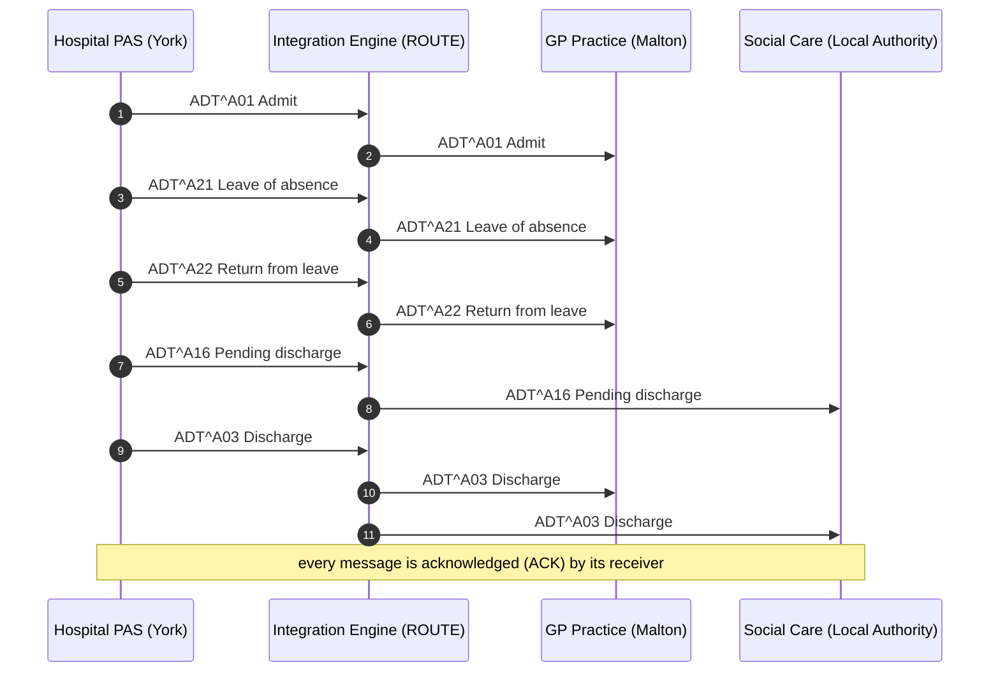

### Events and recipients

| Step | Event | IHE option | Date/time (EVN-2) | Encounter after the event | GP Practice | Social Care | FHIR Message |
|------|-------|------------|-------------------|---------------------------|:-----------:|:-----------:|--------------|
| 1 | ADT^A01 Admit | Basic Subset | 2 Nov 2026 14:30 | `in-progress`, `period.start` | ✓ | | [scenario-a01](Bundle-scenario-a01.html) |
| 2 | ADT^A21 Leave of absence | Advanced Encounter Management | 6 Nov 2026 10:00 | `onleave` | ✓ | | [scenario-a21](Bundle-scenario-a21.html) |
| 3 | ADT^A22 Return from leave | Advanced Encounter Management | 8 Nov 2026 18:00 | `in-progress` | ✓ | | [scenario-a22](Bundle-scenario-a22.html) |
| 4 | ADT^A16 Pending discharge | Pending Event Management | 10 Nov 2026 09:00 | `in-progress`, expected discharge 12 Nov 2026 11:00 (PV2-9) | | ✓ | [scenario-a16](Bundle-scenario-a16.html) |
| 5 | ADT^A03 Discharge | Basic Subset | 12 Nov 2026 11:30 | `finished`, `period.end`, discharge destination | ✓ | ✓ | [scenario-a03](Bundle-scenario-a03.html) |
{:.grid}

### Hospital Provider Spell

Every message identifies the same stay as an admitted patient, the **Hospital Provider Spell** `5000123`:

- in HL7 v2.5.1, `PV1-19` Visit Number with CX-5 = `AN` (`5000123^^^RCB^AN`);
- in FHIR, `Encounter.identifier` ([Hospital Provider Spell Identifier](StructureDefinition-HospitalProviderSpellIdentifier.html)) of the same Encounter resource, `Encounter/inpatient-spell-5000123`, in every message. Each message carries the Encounter as it is after the event, so a Consumer updates one Encounter rather than creating a new one.

HL7 v2 Table 0203 has no Hospital Provider Spell type, so `AN` (Account number) is used as an interim workaround.

### HL7 v2.5.1 messages

The messages as sent by the PAS to the integration engine. The engine forwards them unchanged to the GP practice and social care, apart from MSH-5/MSH-6.



### Routing

The integration engine applies the routing rules. The GP practice is identified by the patient's registered practice (PD1-3, ODS code Y06601). Social care is identified by local agreement, for example by the patient's local authority of residence.

The GP practice receives the events that tell it where its patient is. Social care receives the pending discharge, so that it can plan care and support at home before the expected discharge date, and the discharge itself. Each Consumer only needs to support the events it receives. A Consumer that does not support an option application-rejects messages for it (see [PAM Actor Options](PAM.html#actor-options)).

Before sending events to social care, local information governance arrangements (for example the purpose of discharge planning and the patient's consent where required) **shall** be in place. [Location Hiding](hl7v2-zsegments.html#zu8---uk-miscellaneous-demographic-data) **shall** be honoured by every Consumer.
