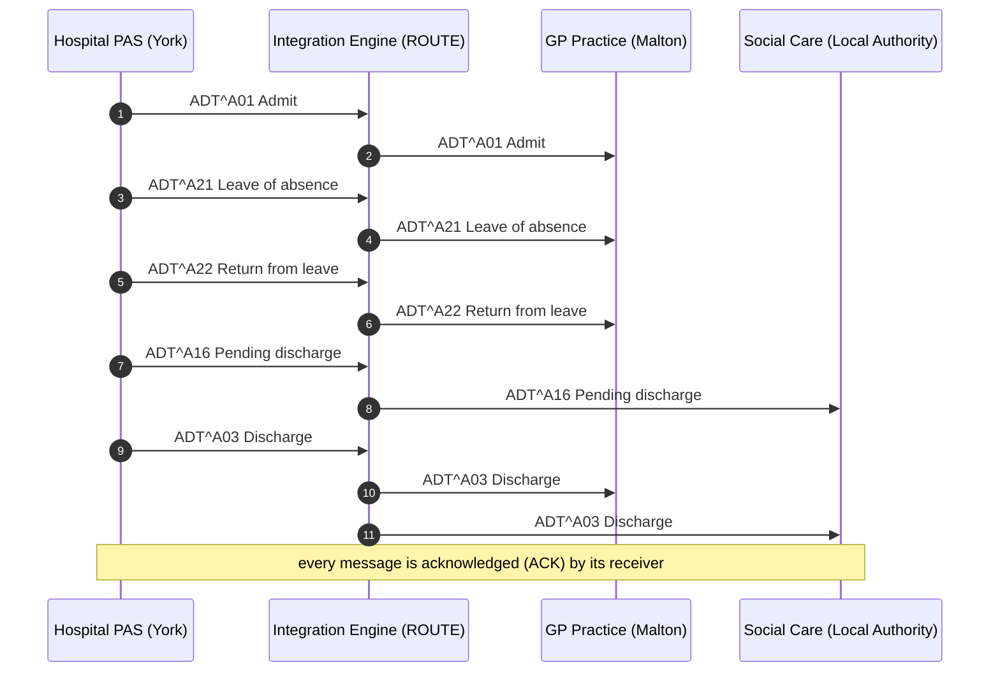

### Events and recipients

| Step | Event | IHE option | Visit (PV1-19) | Hospital Provider Spell (PID-18) | Encounter after the event | GP Practice | Social Care | FHIR Message |
|------|-------|------------|----------------|----------------------------------|---------------------------|:-----------:|:-----------:|--------------|
| 1 | ADT^A01 Admit | Basic Subset | 2139 | 5000123 | `in-progress` | ✓ | | [hscic-a01-encounter](Bundle-hscic-a01-encounter.html) |
| 2 | ADT^A21 Leave of absence | Advanced Encounter Management | 1164 | 5000123 | `onleave` | ✓ | | [hscic-a21-advanced](Bundle-hscic-a21-advanced.html) |
| 3 | ADT^A22 Return from leave | Advanced Encounter Management | 1164 | 5000123 | `in-progress` | ✓ | | [hscic-a22-advanced](Bundle-hscic-a22-advanced.html) |
| 4 | ADT^A16 Pending discharge | Pending Event Management | 1114 | 5000123 | `in-progress`, expected discharge (PV2-9) | | ✓ | [hscic-a16-pending](Bundle-hscic-a16-pending.html) |
| 5 | ADT^A03 Discharge | Basic Subset | YOR123456 | 5000123 | `finished`, discharge destination | ✓ | ✓ | [hscic-a03-encounter](Bundle-hscic-a03-encounter.html) |
{:.grid}

### Hospital Provider Spell

The steps use the HSCIC ITK example messages, which record each event against a different **visit** (`PV1-19`). A Consumer ties them together into one stay as an admitted patient with the **Hospital Provider Spell** number:

- in HL7 v2.5.1, `PID-18` Patient Account Number with CX-5 = `AN` (e.g. `5000123^^^SPELLID^AN`);
- in FHIR, `Encounter.partOf` as a logical reference by [Hospital Provider Spell Identifier](StructureDefinition-HospitalProviderSpellIdentifier.html).

HL7 v2 Table 0203 has no Hospital Provider Spell type, so `AN` (Account number) is used as an interim workaround. The HSCIC originals do not carry PID-18: it is added to these five examples for this scenario (see [HSCIC ITK Example Messages](hscic-examples.html), where it is listed as a change).

The message dates come from the separate HSCIC ITK examples (February to October 2010), so they are not in the order of the scenario steps. Read the scenario for the sequence of events and the spell identifier, not for the dates.

### Routing

The integration engine applies the routing rules. The GP practice is identified by the patient's registered practice (PD1-3, ODS code Y06601). Social care is identified by local agreement, for example by the patient's local authority of residence.

The GP practice receives the events that tell it where its patient is. Social care receives the pending discharge, so that it can plan care and support at home before the expected discharge date, and the discharge itself. Each Consumer only needs to support the events it receives. A Consumer that does not support an option application-rejects messages for it (see [PAM Actor Options](PAM.html#actor-options)).

Before sending events to social care, local information governance arrangements (for example the purpose of discharge planning and the patient's consent where required) **shall** be in place. [Location Hiding](hl7v2-zsegments.html#zu8---uk-miscellaneous-demographic-data) **shall** be honoured by every Consumer.
