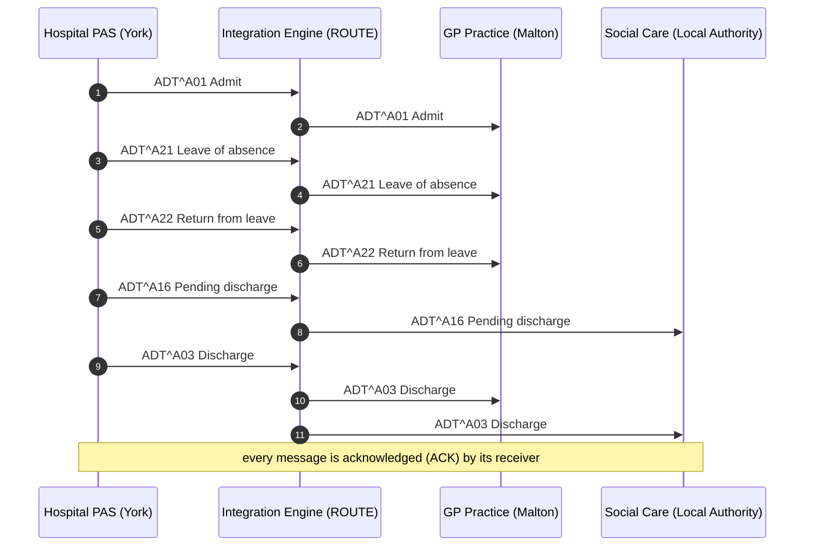

### Events and recipients

| Step | Event | IHE option | Encounter after the event | GP Practice | Social Care | FHIR Message |
|------|-------|------------|---------------------------|:-----------:|:-----------:|--------------|
| 1 | ADT^A01 Admit | Basic Subset | `in-progress`, Ward OBS1 `active` | ✓ | | [hscic-a01-encounter](Bundle-hscic-a01-encounter.html) |
| 2 | ADT^A21 Leave of absence | Advanced Encounter Management | `onleave`, bed `reserved` | ✓ | | [scenario-a21-leave](Bundle-scenario-a21-leave.html) |
| 3 | ADT^A22 Return from leave | Advanced Encounter Management | `in-progress`, Ward OBS1 `active` | ✓ | | [scenario-a22-return](Bundle-scenario-a22-return.html) |
| 4 | ADT^A16 Pending discharge | Pending Event Management | `in-progress`, ready for discharge (ZU1-24), expected discharge (PV2-9) | | ✓ | [scenario-a16-pending](Bundle-scenario-a16-pending.html) |
| 5 | ADT^A03 Discharge | Basic Subset | `finished`, discharge method and destination | ✓ | ✓ | [scenario-a03-discharge](Bundle-scenario-a03-discharge.html) |
{:.grid}

All the messages are about the same Hospital Provider Spell (visit number 2139) and the same patient. Step 1 is the HSCIC ITK Inpatient Admission example; steps 2 to 5 continue that spell. The separate HSCIC ITK leave, pending discharge and discharge examples are about other visits, so they are not used here. See [HSCIC ITK Example Messages](hscic-examples.html).

### Routing

The integration engine applies the routing rules. The GP practice is identified by the patient's registered practice (PD1-3, ODS code Y06601). Social care is identified by local agreement, for example by the patient's local authority of residence.

The GP practice receives the events that tell it where its patient is. Social care receives the pending discharge, so that it can plan care and support at home before the expected discharge date, and the discharge itself. Each Consumer only needs to support the events it receives. A Consumer that does not support an option application-rejects messages for it (see [PAM Actor Options](PAM.html#actor-options)).

Before sending events to social care, local information governance arrangements (for example the purpose of discharge planning and the patient's consent where required) **shall** be in place. [Location Hiding](hl7v2-zsegments.html#zu8---uk-miscellaneous-demographic-data) **shall** be honoured by every Consumer.
