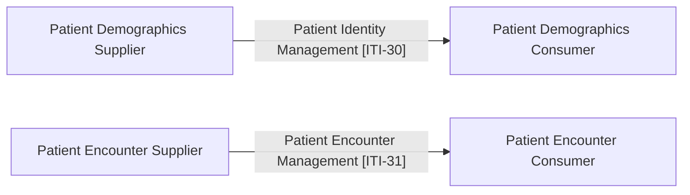
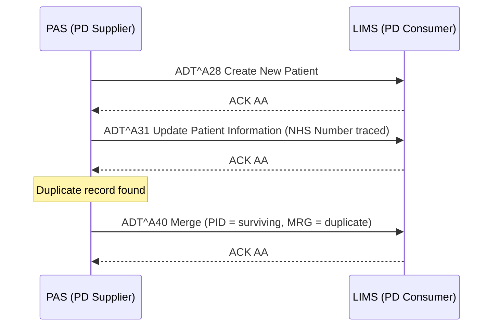
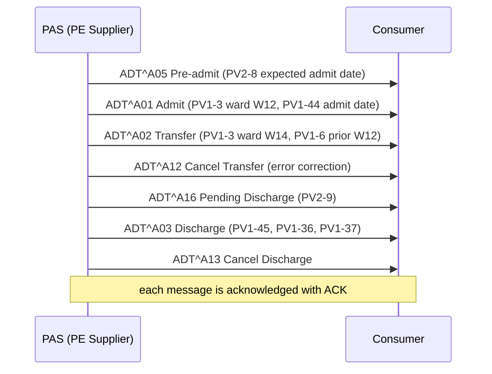

This page is the UK national extension of [IHE ITI TF-1: 14 Patient Administration Management (PAM)](https://profiles.ihe.net/ITI/TF/Volume1/ch-14.html).

### Actors and Transactions

| Actor | Transaction | Optionality | Actor Definition | Capability Statement |
|-------|-------------|-------------|------------------|----------------------|
| Patient Demographics Supplier | [ITI-30](ITI-30.html) | R | [ActorDefinition](ActorDefinition-PatientDemographicsSupplier.html) | [Requirements](CapabilityStatement-PAMPatientDemographicsSupplier.html) |
| Patient Demographics Consumer | [ITI-30](ITI-30.html) | R | [ActorDefinition](ActorDefinition-PatientDemographicsConsumer.html) | [Requirements](CapabilityStatement-PAMPatientDemographicsConsumer.html) |
| Patient Encounter Supplier | [ITI-31](ITI-31.html) | R | [ActorDefinition](ActorDefinition-PatientEncounterSupplier.html) | [Requirements](CapabilityStatement-PAMPatientEncounterSupplier.html) |
| Patient Encounter Consumer | [ITI-31](ITI-31.html) | R | [ActorDefinition](ActorDefinition-PatientEncounterConsumer.html) | [Requirements](CapabilityStatement-PAMPatientEncounterConsumer.html) |
{:.grid}

In both transactions the Supplier initiates and the Consumer responds. Every message is acknowledged with an HL7 `ACK` (see [HL7 v2.5.1 Conventions](hl7v2.html#acknowledgements)).

#### UK actor mapping

| IHE actor | Typical NHS system |
|-----------|--------------------|
| Patient Demographics Supplier + Patient Encounter Supplier | Trust PAS / EPR (e.g. ADT module), Emergency Department system, Community PAS |
| Patient Demographics Consumer + Patient Encounter Consumer | LIMS, RIS, pharmacy, theatres, maternity, Shared Care Record, regional integration engine (RIE) |
| Patient Demographics Consumer | Trust MPI fed from PAS, Genomic LIMS |
{:.grid}

An integration engine that receives from the PAS and re-broadcasts (the HSCIC ITK `ROUTE` pattern, see [MSH](hl7v2-segments.html#msh---message-header)) acts as a Consumer to the PAS and as a Supplier to downstream systems.

### Actor Options

| Actor | Option | IHE reference | Trigger events | HSCIC ITK (2014) | This guide |
|-------|--------|---------------|----------------|------------------|------------|
| PD Supplier / Consumer | Merge | ITI TF-2: 3.30.4.1 | A40 | 3.1.4 | **Required** (Note 1) |
| PD Supplier / Consumer | Link / Unlink | ITI TF-2: 3.30.4.2 | A24, A37 | not defined | Not used |
| PD Supplier / Consumer | Acknowledgement Support | ITI TF-2: 3.30.4.4 | - | MSH-15/16 not supported | Optional |
| PD Supplier | Ambulatory Patient Data | ITI TF-2: 3.30.4.5 | - | - | Optional |
| PE Supplier / Consumer | Basic Subset | ITI TF-2: 3.31.5.1 | A01, A03, A04, A11, A13 | 3.1.1 | **Required** |
| PE Supplier / Consumer | Inpatient / Outpatient Encounter Management | ITI TF-2: 3.31.5.2 | + A02, A05, A06, A07, A12, A38 | 3.1.1 (except A06, A07) | Recommended |
| PE Supplier / Consumer | Pending Event Management | ITI TF-2: 3.31.5.3 | + A14, A15, A16, A25, A26, A27 | 3.1.2 | Optional |
| PE Supplier / Consumer | Advanced Encounter Management | ITI TF-2: 3.31.5.4 | + A21, A22, A44, A52, A53, A54, A55 | 3.1.3 (A21, A22, A52, A53 only) | Optional |
| PE Supplier / Consumer | Temporary Patient Transfers Tracking | ITI TF-2: 3.31.5.5 | + A09, A10, A32, A33 | not defined | Optional |
| PE Supplier / Consumer | Historic Movement Management | ITI TF-2: 3.31.5.6 | ZBE segment, Z99 | not defined | Optional |
| PE Supplier / Consumer | Acknowledgement Support | ITI TF-2: 3.31.5.7 | - | not supported | Optional |
| PE Supplier | Ambulatory Patient Data | ITI TF-2: 3.31.5.8 | PID-11, PV1-8, PV1-15 | - | Optional |
| PE Supplier / Consumer | Maintain Demographics | ITI TF-2: 3.31.5.9 | + A08, A40 | 3.1.1 (A08, A40) | **Required** |
{:.grid}

<b>Note 1 (UK):</b> IHE requires a national extension to select at least one of Merge and Link/Unlink, and to mandate the same option for both PD actors. HSCIC ITK only defines A40 Merge, so this UK extension mandates the <b>Merge Option</b> for the Patient Demographics Supplier and the Patient Demographics Consumer.

<b>Note 2 (UK):</b> HSCIC ITK includes A08 and A40 in every encounter subset. This extension therefore mandates the <b>Maintain Demographics Option</b> for the Patient Encounter Supplier and Consumer, so that existing ITK feeds conform.

A Consumer that does not support an option **shall** application-reject (`MSA-1` = `AR`) a message it does not support (ITI TF-2: C.2.3).

### Required Actor Groupings

| Actor | Required grouping |
|-------|-------------------|
| Patient Encounter Supplier | Patient Demographics Supplier and/or Patient Demographics Consumer |
| Patient Encounter Consumer | None |
| Patient Demographics Supplier | None |
| Patient Demographics Consumer | None |
| All actors (UK) | IHE Consistent Time (CT). HSCIC ITK: "all participating systems should be registered on the same consistent time server" |
{:.grid}

Groupings with other profiles:

- **PIX:** a Patient Demographics Supplier can also act as a PIX Patient Identity Source using ITI-30 (see [PIX](PIX.html)).
- **PDQ / PDQm:** grouping a PDQ Patient Demographics Supplier with the PAM suppliers provides the HSCIC ITK Q21/Q22/ZV1 queries.
- **IHE Radiology SWF / Laboratory LTW:** the Order Placer and Order Filler are grouped with a Patient Encounter Consumer, as in the [NW Genomics LTW guide](https://nw-gmsa.github.io/en/).

### Process Flows

#### Patient identity management

#### Inpatient journey

The worked example, with HL7 v2.5.1 and FHIR versions of the messages, is on [Testing and Example Messages](testing.html).

#### Example Scenario: notifying the GP and social care

[Inpatient admission, leave and discharge](ExampleScenario-InpatientLeaveAndDischarge.html) follows one Hospital Provider Spell (admission, leave of absence, return, pending discharge and discharge). The integration engine routes the events to the patient's GP practice and, for discharge planning, to social care.
