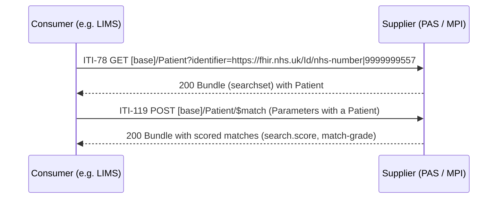

This page is the UK national extension of [IHE ITI Patient Demographics Query for Mobile (PDQm)](https://profiles.ihe.net/ITI/PDQm/) version 3.2.0 (Trial Implementation, FHIR R4, package `ihe.iti.pdqm#3.2.0`).

This section is currently being elaborated.

PDQm is the FHIR equivalent of IHE PDQ, and therefore of the HSCIC ITK queries in section 3.1.5 (QBP^Q21, QBP^Q22, QBP^ZV1). A system that holds patient demographics (a PAS, Trust MPI or regional MPI) answers queries from systems that need to find a patient.

### Actors and Transactions

| Actor | Transaction | Optionality | UK system | IHE CapabilityStatement |
|-------|-------------|-------------|-----------|-------------------------|
| Patient Demographics Consumer | Mobile Patient Demographics Query [ITI-78] | O (Note 1) | LIMS, RIS, Shared Care Record, mobile/clinical apps | [Query](https://profiles.ihe.net/ITI/PDQm/CapabilityStatement-IHE.PDQm.PatientDemographicsConsumerQuery.html) |
| Patient Demographics Consumer | Patient Demographics Match [ITI-119] | O (Note 1) | as above | [Match](https://profiles.ihe.net/ITI/PDQm/CapabilityStatement-IHE.PDQm.PatientDemographicsConsumerMatch.html) |
| Patient Demographics Supplier | Mobile Patient Demographics Query [ITI-78] | R | PAS / EPR, Trust MPI, regional MPI | [Supplier](https://profiles.ihe.net/ITI/PDQm/CapabilityStatement-IHE.PDQm.PatientDemographicsSupplier.html) |
| Patient Demographics Supplier | Patient Demographics Match [ITI-119] | O | as above | [Supplier Match](https://profiles.ihe.net/ITI/PDQm/CapabilityStatement-IHE.PDQm.PatientDemographicsSupplierMatch.html) |
{:.grid}

Note 1: a Consumer shall implement at least one of ITI-78 and ITI-119. PDQm has no required actor groupings.

### Mapping from HSCIC ITK queries

| HSCIC ITK (v2) | PDQm | Notes |
|----------------|------|-------|
| QBP^Q21 / RSP^K21 Get Person Demographics (by identifier) | ITI-78 <code>GET [base]/Patient?identifier=[system]&#124;[value]</code> | QPD-3 PersonIdentifier → `identifier`. QPD-4 WhatDomainsReturned → additional <code>identifier=[system]&#124;</code> parameters (OR) that restrict the identifier domains returned |
| QBP^Q22 / RSP^K22 Find Candidates (by demographics) | ITI-78 search (`family`, `given`, `birthdate`, `gender`, `address-postalcode`) or ITI-119 `$match` | HSCIC notes that PDQ typically uses probabilistic matching with thresholds: in FHIR this is ITI-119 `$match`, which returns a score and match-grade for each candidate |
| QBP^ZV1 / RSP^ZV2 Patient Demographics and Visit Query | No PDQm equivalent | Encounters are found with a FHIR search on Encounter (e.g. IPA / QEDm) |
| QCN^J01 Cancel Query | Not needed | FHIR search is stateless; paging uses Bundle links |
{:.grid}

Example: the [PDQm search response](Bundle-pdqm-search-nhs-number.html) for the HSCIC example patient (EDITESTPATIENT TEN).

### Search parameters (ITI-78)

The Supplier shall support all of these, AND/OR combinations, the `:exact` modifier on string parameters, and at least the combinations `family` + `gender` and `birthdate` + `family`.

| Parameter | v2 (PID) | UK usage |
|-----------|----------|----------|
| `_id` | - | FHIR logical id |
| `active` | - | `active=true` to exclude merged (non-surviving) records |
| `identifier` | PID-3 | NHS Number: <code>identifier=https://fhir.nhs.uk/Id/nhs-number&#124;9999999557</code>. Local MRN: <code>identifier=urn:oid:[assigning authority OID]&#124;[MRN]</code> |
| `family`, `given` | PID-5 | |
| `birthdate` | PID-7 | |
| `gender` | PID-8 | FHIR administrative gender (see [ConceptMap](ConceptMap-HSCICSexToFHIRGender.html)) |
| `address`, `address-city`, `address-postalcode`, `address-country`, `address-state` | PID-11 | `address-postalcode` is the most selective UK search |
| `telecom` | PID-13, PID-14 | |
| `mothersMaidenName` | PID-6 | |
{:.grid}

### UK national extension

- **Identifiers:** [IHE.PDQm.Patient](https://profiles.ihe.net/ITI/PDQm/StructureDefinition-IHE.PDQm.Patient.html) requires `system` on every identifier. The NHS Number uses `https://fhir.nhs.uk/Id/nhs-number`. A local identifier (MRN) **shall** use the OID of its assigning authority as `urn:oid:` (for example under the Trust's [HL7 UK](https://www.hl7.org.uk/standards/object-identifiers-oids/hl7-uk-issued-oids/) root OID). Local identifiers without a known system cannot be exchanged with PDQm; this guide does not invent identifier URIs.
- **Profiles:** a Supplier returns Patients that conform to IHE.PDQm.Patient. The [PAM Patient](StructureDefinition-PAMPatient.html) is compatible when every identifier has a system.
- **Merged patients:** a non-surviving record is either excluded, or returned with `active = false` and `link.type = replaced-by` pointing to the surviving Patient (see [ITI-30](ITI-30.html) A40).
- **Location Hiding:** Suppliers **shall** apply [ZU8-4 Location Hiding](hl7v2-zsegments.html#zu8---uk-miscellaneous-demographic-data) and the PDS S-flag to the Patient resources they return.
- **National services:** the NHS England [Personal Demographics Service](https://digital.nhs.uk/services/personal-demographics-service) FHIR API provides national demographics search. It is not an IHE PDQm implementation.

### Security

ITI-78 and ITI-119 shall be audited (IHE BALP Query events) and may be authorised with IHE IUA (scopes `ITI-78`, `ITI-119`).
