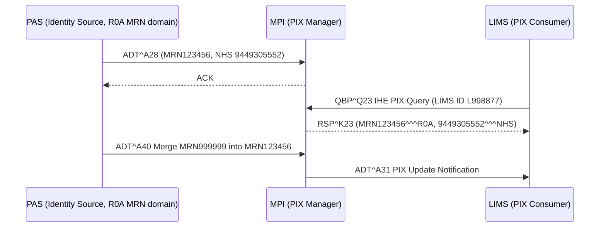

This page is the UK national extension of [IHE ITI TF-1: 5 Patient Identifier Cross-referencing (PIX)](https://profiles.ihe.net/ITI/TF/Volume1/ch-5.html).

This section is currently being elaborated. HSCIC ITK did not define PIX transactions. This content describes how the HSCIC ADT feeds and NHS identifiers fit the PIX model.

### Patient identifier domains in the NHS

| Identifier domain | Assigning authority | CX-5 | Example |
|-------------------|---------------------|------|---------|
| NHS Number (England and Wales) | `NHS&2.16.840.1.113883.2.1.4.1&ISO` | `NH` | `9449305552` |
| Trust local hospital number (MRN) | Local, by agreement (HSCIC Table 0363) e.g. `R0A&...&ISO` or a local namespace | `MR` | `MRN123456` |
| Temporary patient number | As for MRN | `MR` (PID-4 / `use` = temp) | |
| Departmental system ID (e.g. LIMS, genomic LIMS) | Local | `PI` | |
{:.grid}

The NHS Number acts as a national cross-reference identifier. It is not a complete replacement for PIX: patients can be untraced, temporary or unknown (`PID-31`), and many departmental systems keep their own identifier domain. The PIX Manager role is typically held by a Trust MPI or a regional Master Patient Index within an integration engine.

### Actors and Transactions

| Actor | Transaction | Optionality | Notes |
|-------|-------------|-------------|-------|
| Patient Identity Source | Patient Identity Feed [ITI-8] (HL7 v2.3.1) | R | |
| Patient Identity Source | Patient Identity Management [ITI-30] (HL7 v2.5) | O | **Recommended in the UK**: a PAM Patient Demographics Supplier (PAS) using [ITI-30](ITI-30.html) can act as the Patient Identity Source |
| PIX Manager | ITI-8 | R | |
| PIX Manager | ITI-30 | O | Recommended in the UK |
| PIX Manager | PIX Query [ITI-9] | R | QBP^Q23 / RSP^K23 |
| PIX Manager | PIX Update Notification [ITI-10] | R | ADT^A31 |
| PIX Consumer | PIX Query [ITI-9] | R | |
| PIX Consumer | PIX Update Notification [ITI-10] | O | |
{:.grid}

Actor definitions: [Patient Identity Source](ActorDefinition-PatientIdentitySource.html), [PIX Manager](ActorDefinition-PatientIdentifierCrossReferenceManager.html), [PIX Consumer](ActorDefinition-PatientIdentifierCrossReferenceConsumer.html).

All PIX actors **shall** be grouped with Consistent Time (CT).

#### FHIR

The FHIR equivalent is [IHE PIXm](https://profiles.ihe.net/ITI/PIXm/) (ITI-83 `$ihe-pix`) and, for the feed, [IHE PMIR](https://profiles.ihe.net/ITI/PMIR/) (ITI-93 Mobile Patient Identity Feed). A PMIR feed is a FHIR message that uses the same patient-merge semantics as [ADT^A40](MessageDefinition-ADT-A40.html). The [PAM Patient](StructureDefinition-PAMPatient.html) profile identifier slices (`nhsNumber`, `localPatientIdentifier`) are the identifiers that `$ihe-pix` would return.

### Options

| Actor | Option | UK |
|-------|--------|----|
| Patient Identity Source, PIX Manager | Pediatric Demographics | Recommended. These fields support matching of newborns and twins (NHS Number tracing is postponed for babies under six weeks, NSTS08): PID-6 Mother's Maiden Name, PID-13 Home Phone, PID-24 Multiple Birth Indicator, PID-25 Birth Order, PID-33 Last Update Date/Time, PID-34 Last Update Facility |
| PIX Consumer | PIX Update Notification | Optional |
{:.grid}

HSCIC ITK marks PID-33 and PID-34 as "not used in ITK". A Patient Identity Source that claims the Pediatric Demographics Option <b>shall</b> populate them when known.

### Process flow

