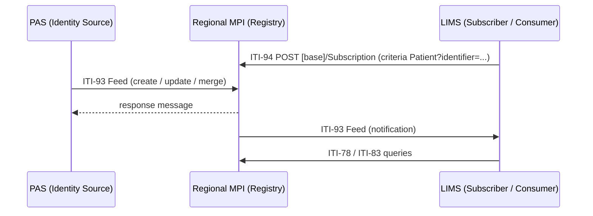

This page is the UK national extension of [IHE ITI Patient Master Identity Registry (PMIR)](https://profiles.ihe.net/ITI/PMIR/) version 1.6.0 (Trial Implementation, FHIR R4, package `ihe.iti.pmir#1.6.0`).

This section is currently being elaborated.

PMIR manages a single **master patient identity** per patient within a Master Patient Identification Domain (for example a regional shared care record or an Integrated Care System). Sources feed identity changes to the Registry. The Registry answers PDQm and PIXm queries and notifies subscribers. In the HSCIC ITK model this is the PAS broadcasting identity changes (ITI-30) via an integration engine, using FHIR.

### Actors and Transactions

| Actor | Transaction | Optionality | UK system |
|-------|-------------|-------------|-----------|
| Patient Identity Source | Mobile Patient Identity Feed [ITI-93] (initiator) | R | PAS / EPR |
| Patient Identity Registry | ITI-93 (initiator and responder), Subscribe to Patient Updates [ITI-94] (responder), [PDQm](PDQm.html) ITI-78 (responder), [PIXm](PIXm.html) ITI-83 (responder) | R | Regional MPI / integration engine |
| Patient Identity Consumer | ITI-93 (responder) | R | LIMS, RIS, Shared Care Record, departmental systems |
| Patient Identity Subscriber | ITI-94 (initiator) | R | as above |
| Patient Demographics Consumer | ITI-78 (initiator) | R | as above |
| Patient Identifier Cross-reference Consumer | ITI-83 (initiator) | R | as above |
{:.grid}

There is one Patient Identity Registry per Master Patient Identification Domain. PMIR has no options and no required groupings.

### Mobile Patient Identity Feed [ITI-93]

ITI-93 is a FHIR message ([IHE.PMIR.Bundle](https://profiles.ihe.net/ITI/PMIR/StructureDefinition-IHE.PMIR.Bundle.html)) with exactly two entries:

1. a [MessageHeader](https://profiles.ihe.net/ITI/PMIR/StructureDefinition-IHE.PMIR.MessageHeader.html) with `eventUri` = `urn:ihe:iti:pmir:2019:patient-feed`, and `focus` on the history Bundle;
2. a `history` Bundle ([IHE.PMIR.Bundle.History](https://profiles.ihe.net/ITI/PMIR/StructureDefinition-IHE.PMIR.Bundle.History.html)) of the Patients created (`POST`), updated (`PUT`) or deleted (`DELETE`).

#### Mapping from PAM [ITI-30]

| HSCIC ITK / PAM v2 | PAM FHIR Message (this guide) | PMIR ITI-93 history entry |
|--------------------|-------------------------------|---------------------------|
| ADT^A28 Create New Patient | [hscic-a28-identity](Bundle-hscic-a28-identity.html) (`eventCoding` A28) | `POST` Patient - [example](Bundle-pmir-feed-create-a28.html) |
| ADT^A31 Update Patient | [hscic-a31-identity](Bundle-hscic-a31-identity.html) (`eventCoding` A31) | `PUT` Patient |
| ADT^A40 Merge | [hscic-a40-identity](Bundle-hscic-a40-identity.html) (`eventCoding` A40) | `PUT` of the non-surviving Patient ([IHE.PMIR.Patient.Merge](https://profiles.ihe.net/ITI/PMIR/StructureDefinition-IHE.PMIR.Patient.Merge.html): `active = false`, one `link` `replaced-by` the surviving Patient), plus `PUT` of the surviving Patient - [example](Bundle-pmir-feed-merge-a40.html) |
| ADT^A47 Change Patient Identifier List | - | `PUT` Patient |
| ITI-31 encounter events (A01-A53) | PAM FHIR Messages | Not in scope of PMIR (patient identity only) |
{:.grid}

The difference: a PAM FHIR Message carries the v2 trigger event (`MessageHeader.eventCoding`, HL7 Table 0003) and the Encounter. A PMIR feed has one event URI for all identity changes, and the change is expressed by the HTTP method of each history entry. Unmerge is not supported: a Registry returns 405 if the `replaced-by` link is removed, unless local policy allows it.

### Subscribe to Patient Updates [ITI-94]

`POST [base]/Subscription` ([IHE.PMIR.Subscription.Request](https://profiles.ihe.net/ITI/PMIR/StructureDefinition-IHE.PMIR.Subscription.Request.html)) with criteria `Patient`, `Patient?_id=`, `Patient?organization=` or `Patient?identifier=`. The Registry supports all of these, and a Subscriber at least one. ITI-94 replaces the PIX Update Notification [ITI-10].

### UK national extension

- **Identifiers:** as for [PDQm](PDQm.html#uk-national-extension): the NHS Number uses `https://fhir.nhs.uk/Id/nhs-number`, and local identifiers **shall** use their assigning authority's OID (`urn:oid:`).
- **Patient content:** Patients follow [IHE.PDQm.Patient](https://profiles.ihe.net/ITI/PDQm/StructureDefinition-IHE.PDQm.Patient.html). [PAM Patient](StructureDefinition-PAMPatient.html) carries the UK demographics (ethnic category, NHS Number verification status, location hiding...) when every identifier has a system.
- **Location Hiding:** a Registry **shall** honour [ZU8-4 Location Hiding](hl7v2-zsegments.html#zu8---uk-miscellaneous-demographic-data) and the PDS S-flag when it notifies Consumers.

### Security

ITI-93 and ITI-94 shall be audited (IHE BALP, [IHE.PMIR.Feed.Audit](https://profiles.ihe.net/ITI/PMIR/StructureDefinition-IHE.PMIR.Feed.Audit.html) and the Subscription audit profiles).
