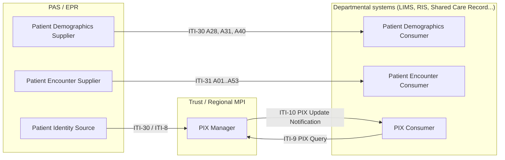

<b>Unofficial draft.</b> This is not an IHE UK, NHS England or HL7 UK publication. It is a working draft, in the style of the <a href="https://nw-gmsa.github.io/en/">NHS North West Genomics IHE LTW guide</a>, intended to inform a potential IHE UK national extension for Patient Administration.

### Purpose

This Implementation Guide is a **UK national extension** of two IHE IT Infrastructure (ITI) profiles:

| IHE Profile | IHE Technical Framework | This guide |
|-------------|-------------------------|------------|
| Patient Administration Management (PAM) | [ITI TF-1: 14](https://profiles.ihe.net/ITI/TF/Volume1/ch-14.html) | [PAM](PAM.html), [ITI-30](ITI-30.html), [ITI-31](ITI-31.html) |
| Patient Identifier Cross-referencing (PIX) | [ITI TF-1: 5](https://profiles.ihe.net/ITI/TF/Volume1/ch-5.html) | [PIX](PIX.html) |
| Patient Demographics Query for Mobile (PDQm) | [PDQm 3.2.0](https://profiles.ihe.net/ITI/PDQm/) | [PDQm](PDQm.html) |
| Patient Identifier Cross-reference for Mobile (PIXm) | [PIXm 3.1.0](https://profiles.ihe.net/ITI/PIXm/) | [PIXm](PIXm.html) |
| Patient Master Identity Registry (PMIR) | [PMIR 1.6.0](https://profiles.ihe.net/ITI/PMIR/) | [PMIR](PMIR.html) |
{:.grid}

It brings together, in one place:

1. **The HSCIC ITK HL7 v2 ADT standard.** The initial content comes from the *HSCIC ITK HL7 V2 Message Specifications* (NPFIT-ELIBR-AREL-DST-0369, v1.0.15, 2014) and *HSCIC ITK HL7 V2 Reference Tables* (NPFIT-ELIBR-AREL-DST-0376, v1.0.14, 2014). Those specifications were based on HL7 v2.4 and HL7 UK A2, with reference to IHE ITI TF-2. They remain the de-facto ADT standard for most NHS PAS/EPR feeds.
2. **HL7 v2.5.1.** The HSCIC content has been moved from v2.4 to v2.5.1, which IHE PAM requires (v2.5). See [Changes from HSCIC ITK v2.4](hscic-changes.html).
3. **HL7 FHIR R4.** The v2 segments are mapped to FHIR profiles based on [HL7 Europe Base](https://hl7.eu/fhir/base/). UK Core extensions and NHS Data Dictionary terminology are used where they exist. FHIR Messaging equivalents of the ADT trigger events are also defined. See the [HL7 v2 to FHIR Mapping](v2-fhir-mapping.html).

### Scope

Out of scope for this version:

- The HL7 v2 HSCIC ITK queries (QBP^Q21 Get Person Demographics, QBP^Q22 Find Candidates, QBP^ZV1 Patient Demographics and Visit Query) are IHE [Patient Demographics Query (PDQ)](https://profiles.ihe.net/ITI/TF/Volume1/ch-8.html) transactions ITI-21 and ITI-22, which are not profiled. Their FHIR equivalents are covered by [PDQm](PDQm.html).
- HSCIC ITK transport (ITK web services / SOAP wrappers). This guide assumes MLLP for HL7 v2 and FHIR Messaging ($process-message) for FHIR.

### Contents

- **Volume 1 - Profiles:** [Overview](overview.html), [PAM](PAM.html), [PIX](PIX.html), [PDQm](PDQm.html), [PIXm](PIXm.html), [PMIR](PMIR.html)
- **Volume 2 - Transactions:** [ITI-30](ITI-30.html), [ITI-31](ITI-31.html), [HL7 v2.5.1 Conventions](hl7v2.html), [Segment Definitions](hl7v2-segments.html), [UK Z Segments](hl7v2-zsegments.html)
- **Volume 3 - Content:** [HL7 v2 to FHIR Mapping](v2-fhir-mapping.html), [Terminology](terminology.html), profiles such as [PAM Patient](StructureDefinition-PAMPatient.html) and [PAM Encounter](StructureDefinition-PAMEncounter.html)
- **Supporting:** [Changes from HSCIC ITK v2.4](hscic-changes.html), [Testing and Example Messages](testing.html), [HSCIC ITK Example Messages](hscic-examples.html), [Artifacts](artifacts.html)

### Dependencies



### Source documents

The original HSCIC documents are held in `Specifications/HSCIC` in the source repository. They are © Crown Copyright / Health and Social Care Information Centre (now NHS England). The text of this guide paraphrases and restructures them. In any conflict, the original documents and the IHE Technical Framework are authoritative.

### Intellectual Property


