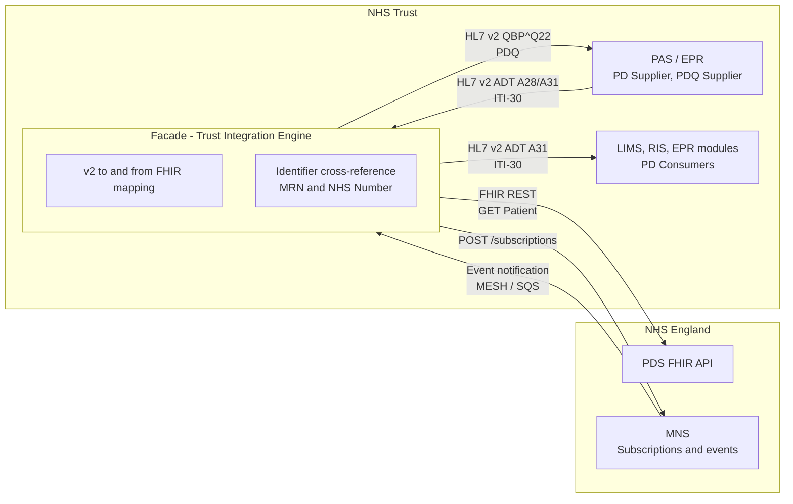
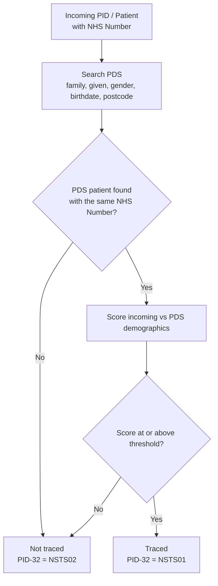
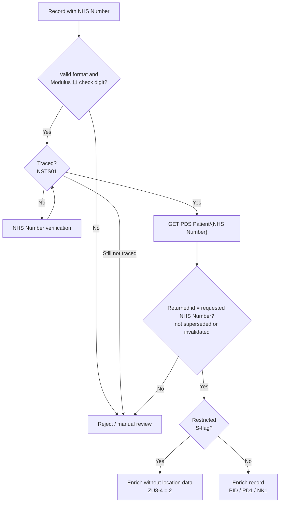
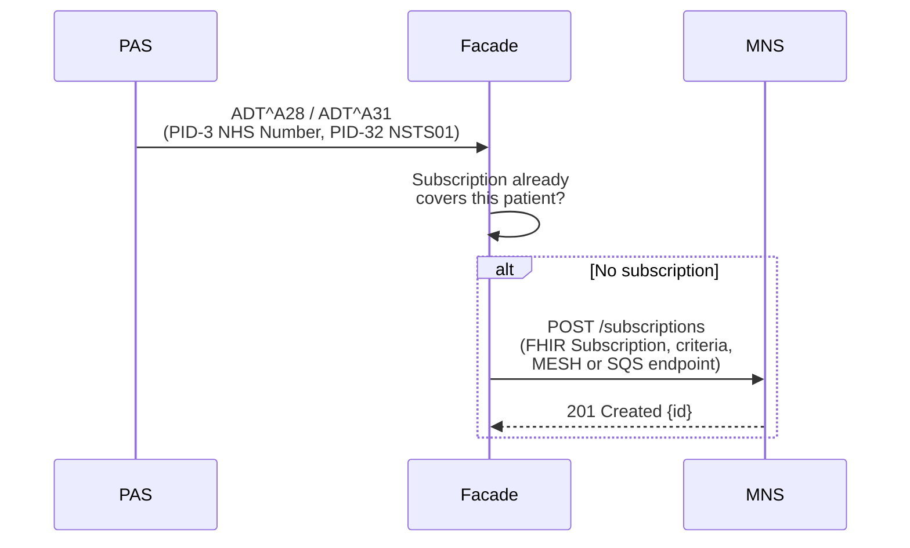
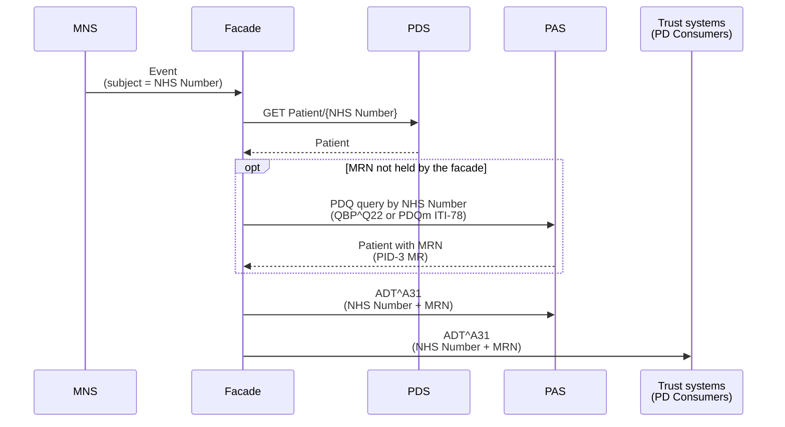

This page describes how NHS Trust systems that use HL7 v2 (IHE PAM, PDQ, PIX) work with NHS England national APIs that use FHIR R4, in particular the [Personal Demographics Service (PDS) FHIR API](https://digital.nhs.uk/developer/api-catalogue/personal-demographics-service-fhir) and the [Multicast Notification Service (MNS)](https://digital.nhs.uk/developer/api-catalogue/multicast-notification-service).

The diagrams are high level. Detailed message flows are given in Example Scenarios, such as [PDS Notifications (MNS) to ADT^A31](scenario-pds-notifications.html).

### The facade pattern

Most systems in an NHS Trust (PAS, LIMS, RIS, EPR modules) exchange patient and encounter events as HL7 v2 ADT ([ITI-30](ITI-30.html), [ITI-31](ITI-31.html)) and do not call FHIR APIs or receive FHIR notifications. NHS England national services are FHIR REST APIs and event subscriptions.

The gap is bridged by a **facade**: a component, usually the Trust Integration Engine (TIE), that sits in front of the existing systems and presents the national FHIR API to them as HL7 v2, and vice versa. The existing systems are not changed. This is the *Facade* pattern described in the HL7 Europe [EU Health Data API: EHR System Composition Patterns](https://build.fhir.org/ig/euridice-org/eu-health-data-api/en/ehr-system-composition.html#facade), where a facade "can expose the API surface in front of a base EHR system" using the base system's own integration points. The facade is treated as part of the deployed system.

The facade is responsible for:

| Responsibility | Notes |
|----------------|-------|
| Format and protocol translation | HL7 v2.5.1 (MLLP) to and from FHIR R4 (HTTPS). See [HL7 v2 to FHIR Mapping](v2-fhir-mapping.html) and the HL7 [V2-to-FHIR IG](https://www.hl7.org/fhir/uv/v2mappings/) |
| Identifier cross-referencing | National APIs use the NHS Number. Trust systems need the local MRN, which also covers patients without an NHS Number. Acts as or uses a PIX Manager / MPI. See [PIX](PIX.html) |
| NHS Number assurance | Only verified (traced) NHS Numbers are used to read or write national data. See [NHS Number verification](#nhs-number-verification) |
| Security | Holds the NHS England credentials: application-restricted (signed JWT) or healthcare worker (NHS CIS2) access. Trust systems never call national APIs directly |
| Sensitive patients | Applies the PDS S-flag (`meta.security` = `R`) and ZU8-4 [Location Hiding](hl7v2-zsegments.html#location-hiding) before data is passed on |
| Reliability | Rate limits (PDS defaults to 5 TPS per application), retries, ordering and audit |
{:.grid}

### NHS Number verification

**Trigger:** the facade receives a patient record (HL7 v2 PID, or a FHIR Patient) with an NHS Number, and needs to know whether that NHS Number belongs to this patient.

The facade searches PDS with the incoming demographics, then compares the incoming patient with the PDS patient using a **match score**. Demographics that do not change over a lifetime, such as date of birth, score higher than those that do, such as address or telephone number.

Illustrative weights (each Trust **shall** set and document its own weights and threshold, and review them for false matches):

| Item | Changes over time? | Example weight |
|------|-------------------|----------------|
| Date of birth | No | 30 |
| Family name | Sometimes (marriage) | 20 |
| Given name | Rarely | 15 |
| Gender | Rarely | 10 |
| Postcode | Often | 15 |
| Address line / telephone | Often | 10 |
| **Threshold** | | **75** |
{:.grid}

The result is recorded against the NHS Number:

| Outcome | HL7 v2 | FHIR ([PAM Patient](StructureDefinition-PAMPatient.html)) |
|---------|--------|------|
| Score meets threshold | PID-32 `NSTS01` Number present and verified | `identifier[nhsNumber].extension` NHSNumberVerificationStatus `01` |
| Score below threshold, or no PDS match | PID-32 `NSTS02` Number present but not traced. `NSTS04` (no match or multiple match) or `NSTS05` (conflict) **may** be used for more detail | NHSNumberVerificationStatus `02` (or `04`, `05`) |
{:.grid}

### Patient demographic enrichment

**Trigger:** the facade has an NHS Number but few or no demographics (for example a referral, order or result that carries only an NHS Number), and needs the full demographics. It often follows [NHS Number verification](#nhs-number-verification).

The facade reads the patient from PDS by NHS Number and adds the PDS demographics to the record.

Enrichment <b>shall</b> only be done when the NHS Number is known to be traced (<code>NSTS01</code>). Enriching an untraced or mistyped NHS Number copies another person's demographics into the record, so that patient data is filed against the wrong person. See <a href="https://www.linkedin.com/feed/update/urn:li:activity:7530565323436195840/">NHS Number errors and mismatches</a>.

Guards against NHS Number errors:

- Check the format (10 digits) and the Modulus 11 check digit before calling PDS.
- Do not enrich if the NHS Number is not traced. Run verification first.
- If PDS returns a different NHS Number (the requested number was superseded), or the record is invalidated, do not enrich automatically. Pass it to the Trust's patient records team.
- If the record already has demographics, compare them with PDS (as in verification) before overwriting. A large disagreement points to the wrong NHS Number, not to out-of-date local data.
- Do not use NHS Numbers from test ranges (for example those starting `999`) in production.

### NHS England MNS to Trust PAS (HL7 v2 A31)

Most Trust systems cannot receive FHIR event notifications, but do accept HL7 v2 ADT / IHE PAM [ITI-30](ITI-30.html) events. The facade turns MNS events into ADT^A31 Update Patient Information messages for the existing ADT feeds.

#### 1. Subscriptions driven by the existing ADT feed

The facade listens to the PAS ADT feed, ideally A28 (add person) and A31 (update person). When a patient with a traced NHS Number is seen and no subscription covers that patient, the facade creates one with the MNS Subscription API ([POST /subscriptions](https://digital.nhs.uk/developer/api-catalogue/multicast-notification-service#post-/subscriptions)).

The MNS Subscription API takes an MNS subset of a FHIR R4 <code>Subscription</code>, with <code>status</code> = <code>requested</code>, a <code>criteria</code> string starting <code>eventType=</code>, and a <code>channel</code> of type <code>message</code> (MESH mailbox or AWS SQS endpoint). The published specification documents filters by event type and by organisation (for example <code>registeredgpodscode</code>), but no per-patient filter. It also limits each subscriber to 50 active subscriptions. How Trust patients are covered (patient-level subscriptions, or event-level subscriptions filtered by the facade against its MPI) <b>shall</b> be agreed with NHS England MNS.

#### 2. Receiving events and sending A31

When events arrive (`pds-record-change-2`, `pds-death-notification-2`, `nhs-number-change-2`), the facade follows the [PDS Notifications (MNS) to ADT^A31](scenario-pds-notifications.html) scenario: it reads the patient from PDS and sends an ADT^A31.

#### 3. Obtaining the MRN {#obtaining-the-mrn}

Trust systems are usually keyed on the MRN (hospital number), because not every patient has an NHS Number. The MRN **should** be included in PID-3 of the A31 (`MRN^^^R0A^MR^R0A`). If the facade does not hold the MRN in its own cross-reference, it **shall** obtain it from the PAS with a patient demographics query on the NHS Number: [PDQ](https://profiles.ihe.net/ITI/TF/Volume2/ITI-21.html) QBP^Q22 / RSP^K22, or [PDQm](PDQm.html) ITI-78 `GET [base]/Patient?identifier=https://fhir.nhs.uk/Id/nhs-number|{NHS Number}`. If the PAS does not know the patient, the event is discarded.

### Related pages

- [Example Scenario: PDS Notifications (MNS) to ADT^A31](scenario-pds-notifications.html)
- [Patient Identity Management [ITI-30]](ITI-30.html)
- [PIX](PIX.html), [PDQm](PDQm.html), [PIXm](PIXm.html), [PMIR](PMIR.html)
- [HL7 v2 to FHIR Mapping](v2-fhir-mapping.html)
