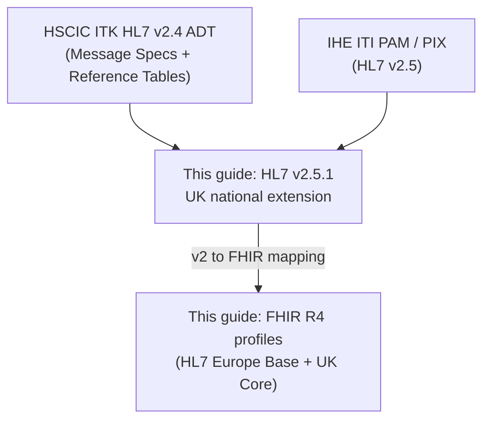

### Patient administration in the NHS

The Patient Administration System (PAS), or the ADT module of an Electronic Patient Record (EPR), is the source of truth in an NHS Trust for:

- **Patient identity**: the NHS Number, the local hospital number (MRN) and demographics, kept in step with the [Personal Demographics Service (PDS)](https://digital.nhs.uk/services/personal-demographics-service).
- **Patient encounters**: inpatient admissions (Hospital Provider Spells), consultant episodes, transfers, leave, discharges, outpatient attendances and A&E attendances.

Downstream systems need this information to work with the correct patient and visit. Examples are LIMS, RIS/PACS, pharmacy, theatres, maternity, shared care records and regional integration engines. Because HSCIC ITK is *broadcast*, the source cannot know how each consumer will use the data.

<b>HSCIC ITK Important Note (retained):</b> data sources (PAS) <b>must send ALL information they hold</b>, whether or not a field is marked optional. Optional (<code>O</code>) usages describe the <i>consumer</i>. For the <i>sender</i>, <code>O</code> is equivalent to <code>RE</code> (required, may be empty). In this guide this is expressed with FHIR <a href="https://hl7.org/fhir/extensions/StructureDefinition-obligation.html">obligations</a> (<code>SHOULD:populate-if-known</code>) on the Supplier actors.

### How the pieces fit

| Layer | Defined by | Content in this guide |
|-------|-----------|-----------------------|
| Actors, transactions, options | IHE PAM, PIX | [PAM](PAM.html), [PIX](PIX.html), [ActorDefinitions](artifacts.html#structures-actor-definitions) |
| Trigger events and message structures | IHE ITI-30 / ITI-31, HSCIC ITK section 4 | [ITI-30](ITI-30.html), [ITI-31](ITI-31.html), [MessageDefinitions](artifacts.html) |
| Segments and fields | HL7 v2.5.1, HSCIC ITK section 5 | [Segment Definitions](hl7v2-segments.html), [Z Segments](hl7v2-zsegments.html) |
| Data types | HL7 v2.5.1, HSCIC ITK section 6 | [HL7 v2.5.1 Conventions](hl7v2.html) |
| Value sets | HSCIC Reference Tables, NHS Data Dictionary | [Terminology](terminology.html) |
| FHIR resources | HL7 Europe Base, UK Core | [HL7 v2 to FHIR Mapping](v2-fhir-mapping.html) |
{:.grid}

### Patient Identity vs Patient Encounter

IHE PAM separates two concerns, which HSCIC ITK mixed together in one list of ADT messages:

| Concern | IHE transaction | HSCIC ITK subset | Trigger events |
|---------|-----------------|------------------|----------------|
| Who the patient is | [Patient Identity Management [ITI-30]](ITI-30.html) | 3.1.4 Patient Identity Management | A28, A31, A40 |
| What is happening to the patient | [Patient Encounter Management [ITI-31]](ITI-31.html) | 3.1.1 Basic, 3.1.2 Advanced, 3.1.3 Further Advanced | A01-A16, A21, A22, A25-A27, A38, A52, A53 (and A08) |
| Finding a patient | PDQ ITI-21 / ITI-22 (out of scope) | 3.1.5 Patient Demographic and Visit Query | Q21/K21, Q22/K22, ZV1/ZV2 |
{:.grid}

### FHIR

Each HL7 v2 message has a FHIR Messaging equivalent: a [PAM Message Bundle](StructureDefinition-PAMBundleMessage.html) whose `MessageHeader.eventCoding` is the HL7 v2 trigger event (`A01`, `A31`...) from HL7 Table 0003. This keeps the event semantics identical across v2 and FHIR, so an integration engine can convert between the two without loss.

The same FHIR profiles ([PAM Patient](StructureDefinition-PAMPatient.html), [PAM Encounter](StructureDefinition-PAMEncounter.html)) can also be used for RESTful access, for example by PDQm or IPA/QEDm, as in the [NW Genomics guide](https://nw-gmsa.github.io/en/).
