### Patient administration in the NHS

The Patient Administration System (PAS), or the ADT module of an Electronic Patient Record (EPR), is the source of truth in an NHS Trust for:

- **Patient identity**: the NHS Number, the local hospital number (MRN) and demographics, kept in step with the [Personal Demographics Service (PDS)](https://digital.nhs.uk/services/personal-demographics-service).
- **Patient encounters**: inpatient admissions (Hospital Provider Spells), consultant episodes, transfers, leave, discharges, outpatient attendances and A&E attendances.

Downstream systems need this information to work with the correct patient and visit. Examples are LIMS, RIS/PACS, pharmacy, theatres, maternity, shared care records and regional integration engines. Because HSCIC ITK is *broadcast*, the source cannot know how each consumer will use the data.

<b>HSCIC ITK Important Note (retained):</b> data sources (PAS) <b>must send ALL information they hold</b>, whether or not a field is marked optional. Optional (<code>O</code>) usages describe the <i>consumer</i>. For the <i>sender</i>, <code>O</code> is equivalent to <code>RE</code> (required, may be empty). In this guide this is expressed with FHIR <a href="https://hl7.org/fhir/extensions/StructureDefinition-obligation.html">obligations</a> (<code>SHOULD:populate-if-known</code>) on the Supplier actors.

### Why event messages?

#### In everyday terms

An **event** is a short message saying that **something has just happened**. It is sent straight away to everyone who needs to know, and each of them decides what to do about it.

**A family WhatsApp group.** When someone is taken to the emergency department or admitted to hospital, a relative usually sends a quick message to the family group: *"Mum's been admitted to Ward 12."* That message is an event. It does not include her medical notes. It just tells everyone what has happened, straight away, and they each act on it: one cancels the visit planned for tomorrow, another rings the ward, another feeds the cat. Later, *"Mum's home!"* is another event, and people act again. Hospital events do the same for the GP, community nurses, social care and other systems: *"this patient has been admitted"*, *"this patient has gone home"*.

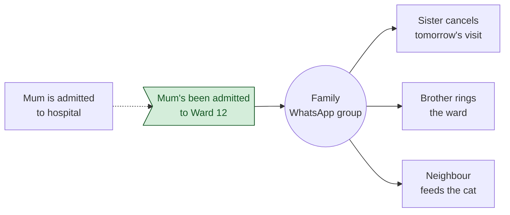

The same pattern in the hospital:

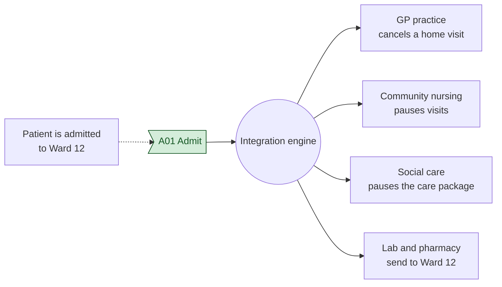

**Your nervous system.** When you touch something hot, your nerves send a signal: *"my hand is hot"*. That signal is an event. It does not explain **why** the hand is hot (a kettle, a radiator, the sun). It just says what has happened, fast enough for you to pull your hand away. Finding out why, and what to do next, needs more information. In healthcare, that further information is the **documents**: referrals, clinic letters and discharge reports (see [Patient journeys](#patient-journeys)). The event says *"the patient has been discharged"*; the discharge report explains why they were in hospital and what should happen next.

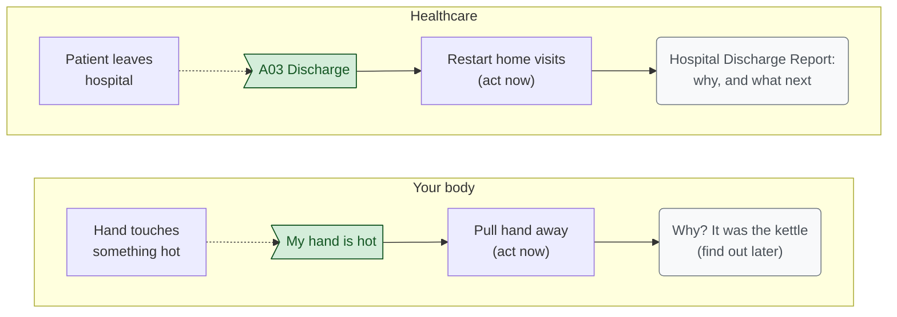

| | Event | Document |
|---|---|---|
| Everyday example | *"Mum's been admitted"* on WhatsApp; *"my hand is hot"* | The hospital's notes on why; finding the kettle |
| Says | **That** something happened, and when | **Why**, and what should happen next |
| Size | Short | Detailed |
| Speed | Sent at once | Written and sent afterwards, sometimes days later |
| Used to | Act now: cancel a visit, prepare a bed, restart care | Inform clinical decisions |
{:.grid}

#### In technical terms

ADT and IHE PAM messages are **events**, not data exchanges. Each message says that something has **happened** to a patient in the hospital: *the patient was admitted*, *the patient moved to Ward 12*, *the patient went home on leave*, *the patient's address changed*. The message carries the data that goes with the event, but the event itself is the point.

This is the same idea as a *domain event* in software architecture, for example in [Domain-Driven Design](https://martinfowler.com/eaaDev/DomainEvent.html) and event-driven architecture:

- An event is a fact about the past, named in the language of the business (admit, transfer, discharge), not in the language of databases (create, update, delete).
- The system where the event happens (the PAS) **publishes** it once. It does not need to know who is listening.
- Each receiving system **decides for itself** what the event means for its own work. The same A02 Transfer moves a bed on the bed board, changes the delivery ward in pharmacy, and changes where the lab sends results.
- Events keep the **reason** for a change. A new ward on the patient's record could be a transfer (A02), a correction of a wrong entry (A08), or a cancelled transfer (A12). A plain copy of the current record cannot tell them apart. The event can.

| | Event (ADT / IHE PAM) | Data exchange (query or copy of a record) |
|---|---|---|
| Question answered | *What has just happened?* | *What is the record now?* |
| Who starts it | The source, when something happens | The receiver, when it needs data |
| Receivers | Many, unknown to the source (broadcast) | One, known to the source |
| Timing | Immediately, in the order things happened | Whenever the receiver asks |
| Keeps the reason for a change | Yes (trigger event, EVN) | No |
| Typical use | Keeping many systems in step with the PAS, triggering work | Looking up a patient, viewing a record |
{:.grid}

Both are needed. Events keep systems in step and start work. Queries ([PDQm](PDQm.html), FHIR RESTful) let a user or application look up the current record.

### Illustrative use cases

The examples below show, in plain terms, what one event can do across the patient's care, both inside the hospital and for other organisations already caring for the patient (GP practice, community nursing, social care, mental health services, care homes). In each case the hospital records the activity once, and every interested system is told, without anyone re-keying it or making a phone call.

| What happens to the patient | Event | Who is told, and what they can do |
|-----------------------------|-------|-----------------------------------|
| A planned admission is booked | A05 Pre-admit | Hospital teams can prepare (theatre lists, pre-operative tests). Carers and community teams can plan around the admission date. |
| The patient attends an emergency department or a hospital appointment | A04 Register | Hospital systems (lab, radiology) know who the patient is, so tests are labelled correctly. The GP and other care providers can be told the patient **has attended**. The clinic letter that follows is a separate document (see the note below). |
| The hospital expects to admit the patient | A14 Pending Admit | A decision to admit has been made (for example in the emergency department, or for a transfer from another hospital), but the patient is not yet on a ward. The receiving ward, bed management and porters can **prepare a bed**. The GP and other providers giving care can be told **early** that the patient is likely to stay in hospital. If the admission does not go ahead, A27 Cancel Pending Admit tells them. |
| The patient is admitted to hospital | A01 Admit | The GP and other providers currently giving care (community nursing, social care, care home) learn the patient is in hospital. They can take action, such as **cancelling a home visit**, pausing a care package, or not chasing a missed appointment. Inside the hospital, ward, bed and pharmacy systems are updated. |
| The patient moves ward or site | A02 Transfer | Everyone involved knows where the patient now is, so results, medicines and visitors go to the right place. If the move was entered by mistake, A12 Cancel Transfer puts everything back. |
| The patient goes home on leave and comes back | A21 Leave / A22 Return | The hospital keeps the bed. Community teams know the patient is at home for a period and may need support. See the [Example Scenario](ExampleScenario-InpatientLeaveAndDischarge.html). |
| The hospital plans to discharge the patient | A16 Pending Discharge | Social care, community teams, the GP or a care home learn **in advance** that the hospital is planning to discharge the patient, with the expected date (PV2-9). They can **prepare**: arrange a care package, equipment or a care home place, so that the patient is not kept in hospital waiting for support. If the plan changes, A25 Cancel Pending Discharge tells them. |
| The patient is discharged | A03 Discharge | The event is a **trigger**: home visits and care packages can **restart**, and social care, the GP or a care home know the patient **is arriving home**. Inside the hospital, the bed is released. |
| The patient's details change (address, phone, GP) | A31 Update Patient | Every system that holds the patient updates its copy, so letters, visits and results reach the patient. The change may come from the national demographic service; see the [PDS Notifications scenario](scenario-pds-notifications.html) for one example. |
| Two records turn out to be the same person | A40 Merge | Results and history held under the duplicate record are brought together, so clinicians see the whole picture. |
| The patient dies | A31 (date of death) or A03 (died in hospital) | All providers can stop future appointments, visits and reminder letters, avoiding distress to the family. |
{:.grid}

<b>An event is not a report.</b> An attendance (A04) or a discharge (A03) event says only that something <b>has happened</b> (the patient attended, the patient has left hospital), at the moment it happens. GPs, social care and other providers will usually also receive a <b>hospital discharge report</b>: a clinic letter after an appointment or a discharge summary after an inpatient stay. That is a clinical document with diagnoses, medicines and follow-up actions. It is written and sent separately, often later, and is not part of IHE PAM. The two should not be confused: the event starts practical actions (restarting visits, expecting the patient home, knowing the patient attended), and the report informs clinical care.

Without events, each of these organisations would have to keep checking whether anything had changed, or staff would have to phone, email or re-enter the same information several times. Both are slow and lead to errors, such as a nurse visiting an empty house while the patient is in hospital.

### Patient journeys

The diagrams below follow typical clinical pathways and show the events sent along the way.

- **Square boxes** are the steps in the pathway: what happens to the patient.
- **Flag shapes** (green) are the **events** a step sends (dotted arrows). These are what this guide defines.
- **Rounded boxes** (grey) are **documents** that come into the hospital (referrals, handovers) or go out of it (clinic letters, discharge reports). Documents are separate from the events and are not part of IHE PAM (see [An event is not a report](#illustrative-use-cases)).

#### Inpatient stay

An admission usually starts with a document: a referral (for example from the GP) or, for emergencies, the ambulance crew's handover to the emergency department. It ends with a Hospital Discharge Report. The admission, leave, return, discharge planning and discharge steps are the [Inpatient admission, leave and discharge](ExampleScenario-InpatientLeaveAndDischarge.html) Example Scenario. All events in the stay carry the same Hospital Provider Spell (PV1-19).

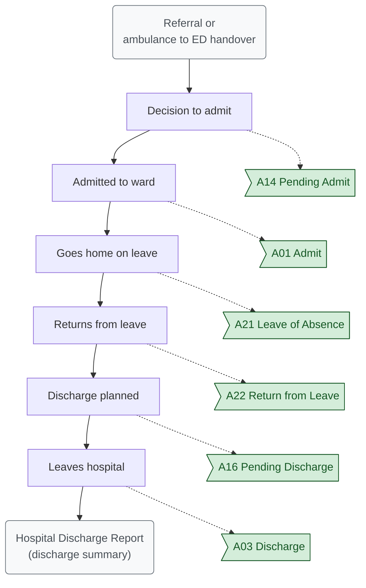

#### Outpatient care

Outpatient care is usually a **series of attendances** for one referral, all under the same outpatient spell (PV1-19). Each attendance has its own identifier (PV1-50). The pattern for each attendance is the same: the patient arrives and checks in (at a kiosk or a staffed reception), sees the consultant, and leaves. The consultant often writes a clinic letter after the attendance. At the last attendance, the consultant writes a discharge letter (Hospital Discharge Report).

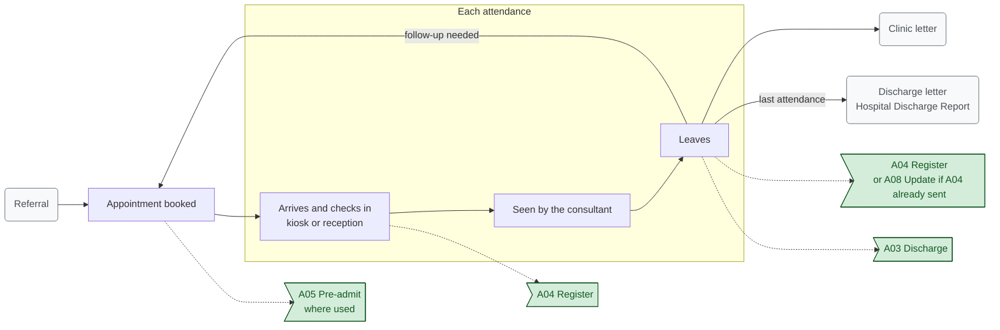

When the patient leaves, the attendance is recorded with an A04 Register. If an A04 was already sent at check-in, an A08 Update Patient Information is sent instead, carrying the completed attendance (for example the attendance outcome). The A03 Discharge marks the end of the attendance.

A cancelled or missed appointment is handled with the cancel events (A38 Cancel Pre-admit, A11 Cancel Registration), so that other systems do not expect the patient.

#### Virtual ward and hospital at home

A virtual ward (or hospital at home) cares for the patient at home, often straight after an inpatient stay. For events it is like outpatient care: the stay on the virtual ward has a start and an end, and **each home visit is like an outpatient attendance**. How the virtual ward is represented (patient class, location, encounter identifiers) **should** be agreed locally.

The home visits are where most of the care happens. Many different people may visit the patient: the GP, community nurses, social workers, therapists, the virtual ward's own clinicians and remote monitoring staff. Each usually works for a different organisation and uses a different system. If each visit sends events, the people caring for the patient **let each other know about their visits**, without phone calls:

- **Visit planned (A05)**: others can see who is coming and when. This avoids two visits on the same morning, or none at all, and lets visits be combined.
- **Visit cancelled (A38)**: others know the visit is not happening, so they can step in.
- **Visitor arrives (A04)** and **visit ends (A03)**: others know the patient has been seen, by whom and when. Lone-worker and safety checks can also use them.

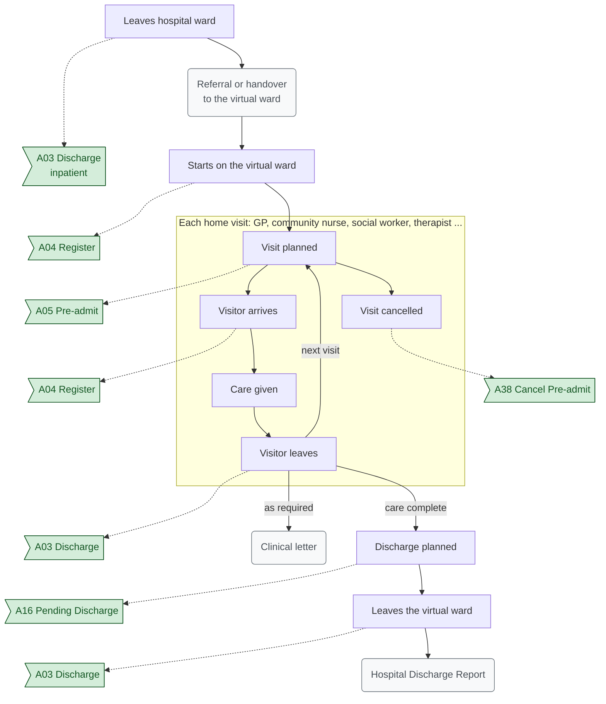

Every visit event is shared with all the organisations caring for the patient (virtual ward team, GP, community nursing, social care), usually through an integration engine or shared care record. Each organisation sends its own visit events and receives everyone else's.

Clinical letters are produced after a visit as required, for example to the GP when treatment changes. Notes on the visit itself (observations, care given) are recorded in each organisation's own record or a shared care record. As with outpatient clinic letters, neither is part of the event.

The events tell the GP, community nursing and social care that the patient is under the hospital's care at home, and when that care ends. This is the same as for an inpatient stay, even though the patient is not in a hospital bed.

<b>Documents and the NHS England Single Patient Record.</b> The documents produced along these pathways (referrals, ambulance handovers, clinic and clinical letters, Hospital Discharge Reports) are likely to be the focus of the NHS England <b>Single Patient Record</b>, which aims to bring together the information each organisation holds about a patient. The events in this guide play a different role. They say <i>when</i> something happens and <i>where</i> the patient is, so that care can be coordinated as it happens. A record of documents and an event feed complement each other: events can tell systems that a new document is expected or that a patient's situation has changed, and the documents hold the clinical detail.

### How events are distributed

Once an event has happened, it has to reach the systems that need it. There are three common patterns, described in [Enterprise Integration Patterns](https://www.enterpriseintegrationpatterns.com/). Back to the WhatsApp analogy: a direct message to one person, a message that someone forwards to a chosen list, or a group that people choose to join.

#### Point-to-point

A [Point-to-Point Channel](https://www.enterpriseintegrationpatterns.com/patterns/messaging/PointToPointChannel.html) carries each message from one sender to **one** receiver. It is the most common pattern inside a Trust's integration engine (TIE): each interface links two systems, for example the PAS to the LIMS. It is also the pattern used by the NHS England [Message Exchange for Social Care and Health (MESH)](https://digital.nhs.uk/services/message-exchange-for-social-care-and-health-mesh), where a message is sent to one named mailbox.

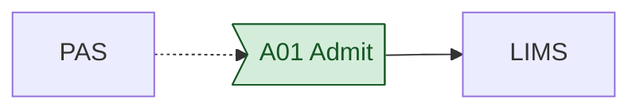

Everyday terms: a direct message to one person. To tell five people, the sender has to send five messages and know who all five are.

#### Message routing

With [Message Routing](https://www.enterpriseintegrationpatterns.com/patterns/messaging/MessageRoutingIntro.html), the sender sends the event once to a router, and the router sends it on to **several** consumers. In a TIE the list of consumers is usually **fixed** and set up by the integration team. The router often uses [content-based routing](https://www.enterpriseintegrationpatterns.com/patterns/messaging/ContentBasedRouter.html): it looks inside the message to decide where it goes. For example, an A01 goes to the Trust's own systems and to the patient's GP system, chosen by the registered GP practice in PD1-3. The [Inpatient admission, leave and discharge](ExampleScenario-InpatientLeaveAndDischarge.html) Example Scenario uses this pattern.

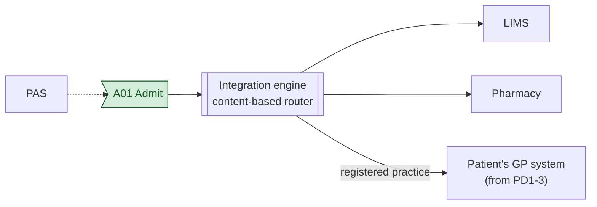

NHS England does not have a national integration engine, so it does not route events in this way. (Technically, Transfer of Care messaging was an exception.) NHS Wales does run a national integration engine, for laboratory document messages.

Everyday terms: you tell one person, and they forward the news to a list of people they already know need it.

#### Publish-subscribe

With a [Publish-Subscribe Channel](https://www.enterpriseintegrationpatterns.com/patterns/messaging/PublishSubscribeChannel.html), the sender **publishes** the event once, and every consumer that has **chosen to subscribe** to that kind of event gets a copy. The sender does not keep a list of consumers; the consumers decide for themselves. The NHS England [Multicast Notification Service (MNS)](https://digital.nhs.uk/developer/api-catalogue/multicast-notification-service) uses this pattern. See the [PDS Notifications scenario](scenario-pds-notifications.html).

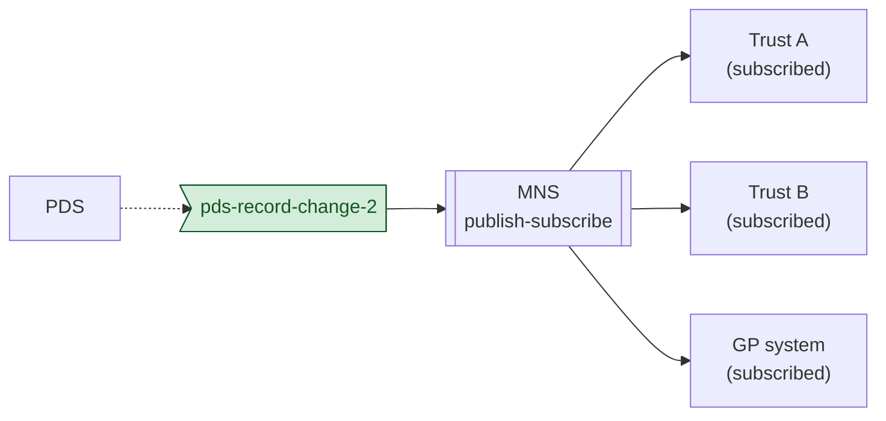

Everyday terms: the family WhatsApp group. Whoever has joined the group sees the message. The sender does not need to know who they are.

#### Comparison

| | Point-to-point | Message routing | Publish-subscribe |
|---|---|---|---|
| Receivers per message | One | Several, from a fixed list | Everyone who has subscribed |
| Who decides who receives | The sender | The integration team (routing rules) | Each consumer |
| Adding a new consumer | New interface from the sender | Change the routing rules | The consumer subscribes |
| Typical use | Interfaces inside a TIE; NHS England MESH | Trust TIE (for example A01 to local systems and the GP); NHS Wales laboratory messages | NHS England MNS |
{:.grid}

The meaning of an event is the same whatever the pattern. A Trust TIE often combines them: it receives MNS events by subscription, turns them into ADT messages (see the [PDS Notifications scenario](scenario-pds-notifications.html)), routes them to a fixed list of consumers, and delivers each one point-to-point.

### Events and FHIR

FHIR is mainly used to **read and update records** through a RESTful API ([FHIR RESTful](https://hl7.org/fhir/R4/http.html)). In that role it does the same job as SQL does against a database. It does not, on its own, replace events:

- FHIR **RESTful** gives the current state of a resource (for example an Encounter). It does not say *why* the resource changed, and the receiver must ask for it.
- FHIR **Subscriptions** ([R4 Backport](https://hl7.org/fhir/uv/subscriptions-backport/), R5) let a client be told when resources on one FHIR server change. This is useful, but it is a notification about one server's data, not a general way to distribute business events across an organisation. National services such as [MNS](https://digital.nhs.uk/developer/api-catalogue/multicast-notification-service) work the same way: the event is a signal, and the receiver then reads the data with FHIR RESTful.
- FHIR **Messaging**, as used in this guide, can carry the same events as HL7 v2 ADT (see [FHIR](#fhir) below).

In practice, events and FHIR RESTful **work together**, at different steps. An event says *what happened*. The receiver then has to **store** the result. That storing step is where FHIR RESTful fits.

**Without FHIR RESTful**, a receiving system handles each ADT event by writing directly to its own database with SQL:

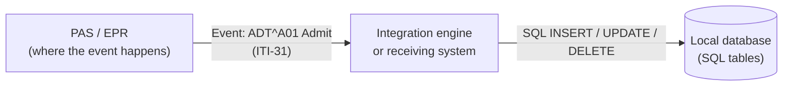

**With FHIR RESTful**, the same event arrives in the same way. Only the storing step changes: the receiver calls a FHIR API on a repository (for example a shared care record or clinical data repository) instead of writing SQL. Applications then read the repository with FHIR RESTful.

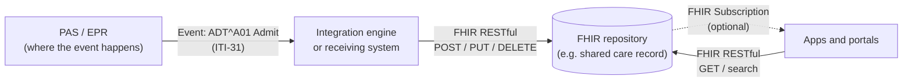

| Event (unchanged) | Without FHIR: SQL on a local database | With FHIR: RESTful call on a FHIR repository |
|-------------------|---------------------------------------|----------------------------------------------|
| A28 New patient | `INSERT INTO patient ...` | `POST Patient` (or conditional `PUT Patient?identifier=...`) |
| A31 Update patient | `UPDATE patient SET address = ...` | `PUT Patient/[id]` |
| A01 Admit | `INSERT INTO encounter ...` | `PUT Encounter` (status `in-progress`) |
| A02 Transfer | `UPDATE encounter SET ward = ...` and `INSERT INTO encounter_location ...` | `PUT Encounter` (new `location`) |
| A11 Cancel admission | `DELETE FROM encounter ...` (or flag as cancelled) | `PUT Encounter` (status `cancelled` / `entered-in-error`) or `DELETE Encounter/[id]` |
| A40 Merge | `UPDATE result SET patient_id = ...` then `DELETE FROM patient ...` (or flag inactive) | `PUT Patient` (`active` = false, `link`) on both records |
{:.grid}

<b>Key point:</b> FHIR RESTful <b>replaces the SQL interactions</b> (create, insert, update, delete on a database), not the events. The HL7 v2 ADT / IHE PAM event is still what tells the receiver that something happened and why. FHIR RESTful is a standard, shared way to store the result, where previously each system wrote to its own database in its own way.

Replacing the PAS event feed with "systems call a FHIR API" moves the work to every receiver. Each must poll for changes, work out what has changed, and guess why. The event feed already answers all three.

<b>What "ITK" means in this guide.</b> When this guide refers to <b>HSCIC ITK</b>, it means <b>only the HL7 v2 ADT message content in the standard "pipe and hat" (ER7) format</b>, for example <code>PID|1||9449305552^^^NHS...</code>. It does <b>not</b> include the rest of the ITK framework: the HL7 v2 XML encoding, the ITK SOAP web services and Distribution Envelope, the ITK infrastructure and business acknowledgements, or ITK addressing and routing. Those extra technical layers made ITK hard to implement and put many NHS Trusts off adopting it. Trusts have mostly exchanged ADT in pipe and hat over MLLP through their integration engines, and that is what this guide builds on.

### How the pieces fit

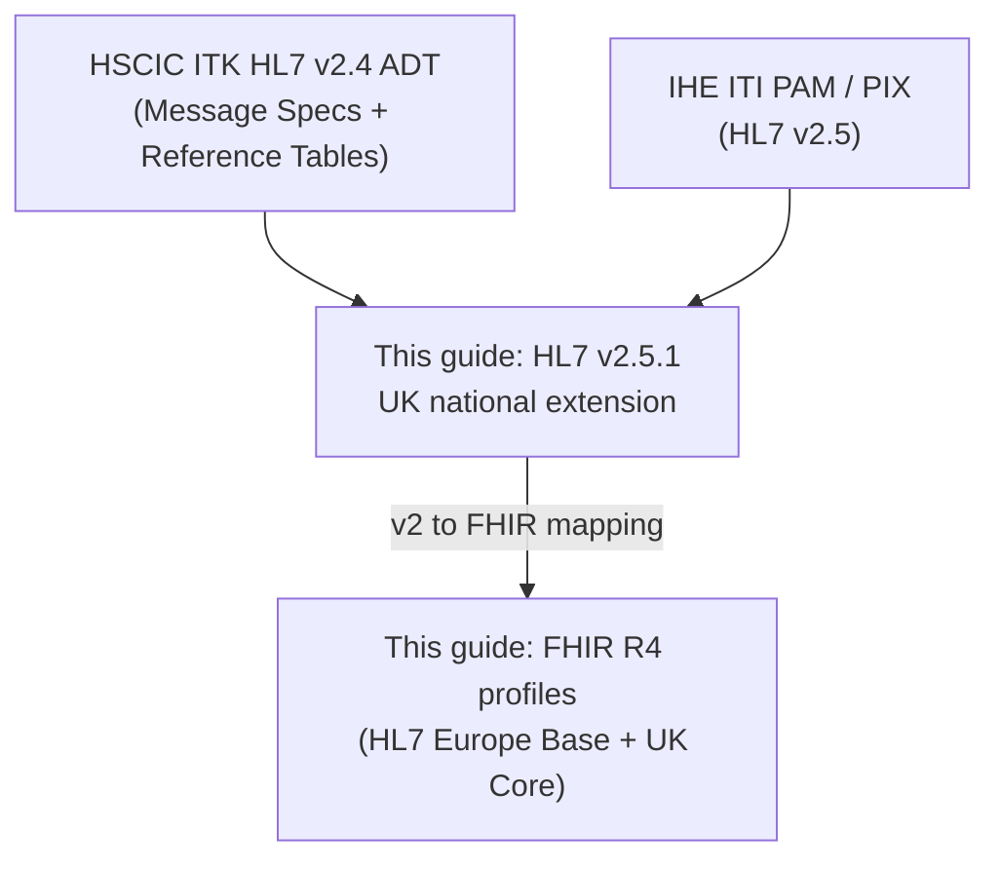

| Layer | Defined by | Content in this guide |
|-------|-----------|-----------------------|
| Actors, transactions, options | IHE PAM, PIX | [PAM](PAM.html), [PIX](PIX.html), [ActorDefinitions](artifacts.html) |
| Trigger events and message structures | IHE ITI-30 / ITI-31, HSCIC ITK section 4 | [ITI-30](ITI-30.html), [ITI-31](ITI-31.html), [MessageDefinitions](artifacts.html) |
| Segments and fields | HL7 v2.5.1, HSCIC ITK section 5 | [Segment Definitions](hl7v2-segments.html), [Z Segments](hl7v2-zsegments.html) |
| Data types | HL7 v2.5.1, HSCIC ITK section 6 | [HL7 v2.5.1 Conventions](hl7v2.html) |
| Value sets | HSCIC Reference Tables, NHS Data Dictionary | [Terminology](terminology.html) |
| FHIR resources | HL7 Europe Base, UK Core | [HL7 v2 to FHIR Mapping](v2-fhir-mapping.html) |
{:.grid}

### Patient Identity vs Patient Encounter

IHE PAM separates two concerns, which HSCIC ITK mixed together in one list of ADT messages:

| Concern | IHE transaction | HSCIC ITK subset | Trigger events |
|---------|-----------------|------------------|----------------|
| Who the patient is | [Patient Identity Management [ITI-30]](ITI-30.html) | 3.1.4 Patient Identity Management | A28, A31, A40 |
| What is happening to the patient | [Patient Encounter Management [ITI-31]](ITI-31.html) | 3.1.1 Basic, 3.1.2 Advanced, 3.1.3 Further Advanced | A01-A16, A21, A22, A25-A27, A38, A52, A53 (and A08) |
| Finding a patient | PDQ ITI-21 / ITI-22 (v2, not profiled); [PDQm](PDQm.html) ITI-78 / ITI-119 (FHIR) | 3.1.5 Patient Demographic and Visit Query | Q21/K21, Q22/K22, ZV1/ZV2 |
| Cross-referencing and master identity (FHIR) | [PIXm](PIXm.html) ITI-83 / ITI-104; [PMIR](PMIR.html) ITI-93 / ITI-94 | - | (A28, A31, A40 as FHIR feeds) |
{:.grid}

### FHIR

Each HL7 v2 message has a FHIR Messaging equivalent: a [PAM Message Bundle](StructureDefinition-PAMBundleMessage.html) whose `MessageHeader.eventCoding` is the HL7 v2 trigger event (`A01`, `A31`...) from HL7 Table 0003. This keeps the event semantics identical across v2 and FHIR, so an integration engine can convert between the two without loss.

The same FHIR profiles ([PAM Patient](StructureDefinition-PAMPatient.html), [PAM Encounter](StructureDefinition-PAMEncounter.html)) can also be used for RESTful access, for example by PDQm or IPA/QEDm, as in the [NW Genomics guide](https://nw-gmsa.github.io/en/).
