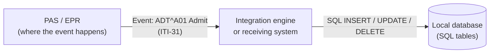
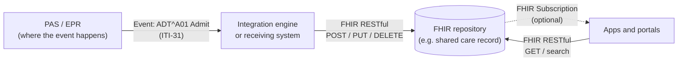
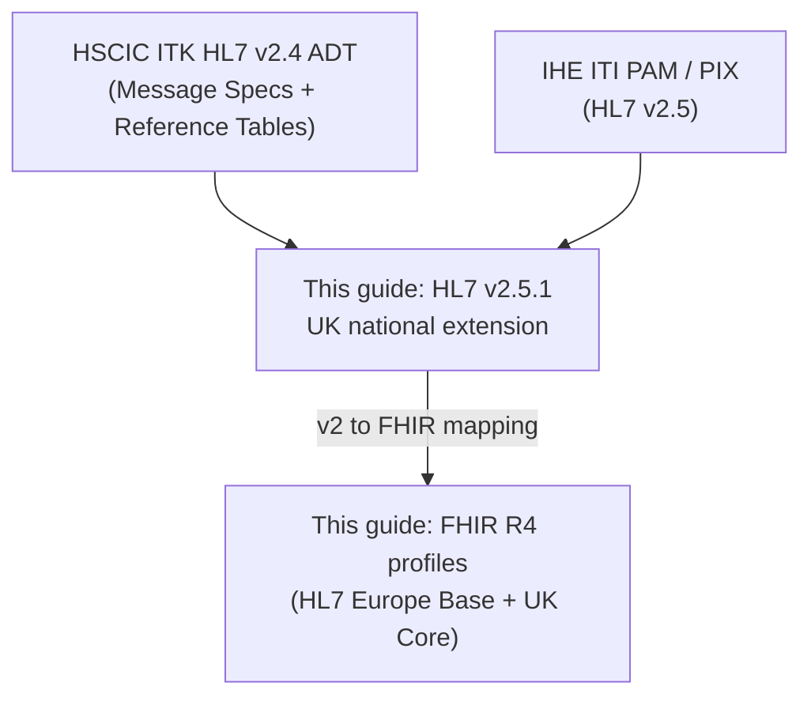

### Patient administration in the NHS

The Patient Administration System (PAS), or the ADT module of an Electronic Patient Record (EPR), is the source of truth in an NHS Trust for:

- **Patient identity**: the NHS Number, the local hospital number (MRN) and demographics, kept in step with the [Personal Demographics Service (PDS)](https://digital.nhs.uk/services/personal-demographics-service).
- **Patient encounters**: inpatient admissions (Hospital Provider Spells), consultant episodes, transfers, leave, discharges, outpatient attendances and A&E attendances.

Downstream systems need this information to work with the correct patient and visit. Examples are LIMS, RIS/PACS, pharmacy, theatres, maternity, shared care records and regional integration engines. Because HSCIC ITK is *broadcast*, the source cannot know how each consumer will use the data.

<b>HSCIC ITK Important Note (retained):</b> data sources (PAS) <b>must send ALL information they hold</b>, whether or not a field is marked optional. Optional (<code>O</code>) usages describe the <i>consumer</i>. For the <i>sender</i>, <code>O</code> is equivalent to <code>RE</code> (required, may be empty). In this guide this is expressed with FHIR <a href="https://hl7.org/fhir/extensions/StructureDefinition-obligation.html">obligations</a> (<code>SHOULD:populate-if-known</code>) on the Supplier actors.

### Why event messages?

ADT and IHE PAM messages are **events**, not data exchanges. Each message says that something has **happened** to a patient in the hospital: *the patient was admitted*, *the patient moved to Ward 12*, *the patient went home on leave*, *the patient's address changed*. The message carries the data that goes with the event, but the event itself is the point.

This is the same idea as a *domain event* in software architecture, for example in [Domain-Driven Design](https://martinfowler.com/eaaDev/DomainEvent.html) and event-driven architecture:

- An event is a fact about the past, named in the language of the business (admit, transfer, discharge), not in the language of databases (create, update, delete).
- The system where the event happens (the PAS) **publishes** it once. It does not need to know who is listening.
- Each receiving system **decides for itself** what the event means for its own work. The same A02 Transfer moves a bed on the bed board, changes the delivery ward in pharmacy, and changes where the lab sends results.
- Events keep the **reason** for a change. A new ward on the patient's record could be a transfer (A02), a correction of a wrong entry (A08), or a cancelled transfer (A12). A plain copy of the current record cannot tell them apart. The event can.

| | Event (ADT / IHE PAM) | Data exchange (query or copy of a record) |
|---|---|---|
| Question answered | *What has just happened?* | *What is the record now?* |
| Who starts it | The source, when something happens | The receiver, when it needs data |
| Receivers | Many, unknown to the source (broadcast) | One, known to the source |
| Timing | Immediately, in the order things happened | Whenever the receiver asks |
| Keeps the reason for a change | Yes (trigger event, EVN) | No |
| Typical use | Keeping many systems in step with the PAS, triggering work | Looking up a patient, viewing a record |
{:.grid}

Both are needed. Events keep systems in step and start work. Queries ([PDQm](PDQm.html), FHIR RESTful) let a user or application look up the current record.

### Illustrative use cases

The examples below show, in plain terms, what one event from the PAS does across a typical NHS Trust. In each case the PAS records the activity once, and the other systems act without anyone re-keying it.

| What happens to the patient | Event | What the event makes happen elsewhere |
|-----------------------------|-------|---------------------------------------|
| A patient is booked for a planned operation next week | A05 Pre-admit | Theatres can schedule the case. Pre-operative tests can be requested against the right patient and stay. |
| A patient arrives in the Emergency Department | A04 Register | The ED system, the lab and radiology know who the patient is, so the first blood test and X-ray are labelled correctly. |
| The patient is admitted to a ward | A01 Admit | The bed board shows the bed as taken. Pharmacy can supply medicines to the ward. The shared care record shows the patient is in hospital. Catering gets dietary needs. |
| The patient moves to another ward | A02 Transfer | Results, medicines and porters go to the new ward. Nurse-call and bed management are updated. If the move was entered by mistake, A12 Cancel Transfer puts everything back. |
| The patient goes home for the weekend and comes back | A21 Leave / A22 Return | The bed is kept but shown as empty. Medicines rounds and observations are paused, then restarted. See the [Example Scenario](ExampleScenario-InpatientLeaveAndDischarge.html). |
| The patient is discharged | A03 Discharge | The bed is released. The discharge summary process starts. Community services and the GP can be told. Future ward-based orders stop. |
| The patient moves house and the GP updates the national record (PDS) | A31 Update Patient | Appointment letters and results go to the new address in every system. See the [PDS Notifications scenario](scenario-pds-notifications.html). |
| Two records turn out to be the same person | A40 Merge | Results and history held under the duplicate record are brought together, so clinicians see the whole picture. |
| The patient dies | A31 (death date) or A03 (died in hospital) | Future appointments and reminder letters can be stopped, avoiding distress to the family. |
{:.grid}

Without events, each of these systems would have to keep asking the PAS whether anything had changed, or staff would have to enter the same information several times. Both are slow and lead to errors.

### Events and FHIR

FHIR is mainly used to **read and update records** through a RESTful API ([FHIR RESTful](https://hl7.org/fhir/R4/http.html)). In that role it does the same job as SQL does against a database. It does not, on its own, replace events:

- FHIR **RESTful** gives the current state of a resource (for example an Encounter). It does not say *why* the resource changed, and the receiver must ask for it.
- FHIR **Subscriptions** ([R4 Backport](https://hl7.org/fhir/uv/subscriptions-backport/), R5) let a client be told when resources on one FHIR server change. This is useful, but it is a notification about one server's data, not a general way to distribute business events across an organisation. National services such as [MNS](https://digital.nhs.uk/developer/api-catalogue/multicast-notification-service) work the same way: the event is a signal, and the receiver then reads the data with FHIR RESTful.
- FHIR **Messaging**, as used in this guide, can carry the same events as HL7 v2 ADT (see [FHIR](#fhir) below).

In practice, events and FHIR RESTful **work together**, at different steps. An event says *what happened*. The receiver then has to **store** the result. That storing step is where FHIR RESTful fits.

**Without FHIR RESTful**, a receiving system handles each ADT event by writing directly to its own database with SQL:

**With FHIR RESTful**, the same event arrives in the same way. Only the storing step changes: the receiver calls a FHIR API on a repository (for example a shared care record or clinical data repository) instead of writing SQL. Applications then read the repository with FHIR RESTful.

| Event (unchanged) | Without FHIR: SQL on a local database | With FHIR: RESTful call on a FHIR repository |
|-------------------|---------------------------------------|----------------------------------------------|
| A28 New patient | `INSERT INTO patient ...` | `POST Patient` (or conditional `PUT Patient?identifier=...`) |
| A31 Update patient | `UPDATE patient SET address = ...` | `PUT Patient/[id]` |
| A01 Admit | `INSERT INTO encounter ...` | `PUT Encounter` (status `in-progress`) |
| A02 Transfer | `UPDATE encounter SET ward = ...` and `INSERT INTO encounter_location ...` | `PUT Encounter` (new `location`) |
| A11 Cancel admission | `DELETE FROM encounter ...` (or flag as cancelled) | `PUT Encounter` (status `cancelled` / `entered-in-error`) or `DELETE Encounter/[id]` |
| A40 Merge | `UPDATE result SET patient_id = ...` then `DELETE FROM patient ...` (or flag inactive) | `PUT Patient` (`active` = false, `link`) on both records |
{:.grid}

<b>Key point:</b> FHIR RESTful <b>replaces the SQL interactions</b> (create, insert, update, delete on a database), not the events. The HL7 v2 ADT / IHE PAM event is still what tells the receiver that something happened and why. FHIR RESTful is a standard, shared way to store the result, where previously each system wrote to its own database in its own way.

Replacing the PAS event feed with "systems call a FHIR API" moves the work to every receiver. Each must poll for changes, work out what has changed, and guess why. The event feed already answers all three.

### How the pieces fit

| Layer | Defined by | Content in this guide |
|-------|-----------|-----------------------|
| Actors, transactions, options | IHE PAM, PIX | [PAM](PAM.html), [PIX](PIX.html), [ActorDefinitions](artifacts.html) |
| Trigger events and message structures | IHE ITI-30 / ITI-31, HSCIC ITK section 4 | [ITI-30](ITI-30.html), [ITI-31](ITI-31.html), [MessageDefinitions](artifacts.html) |
| Segments and fields | HL7 v2.5.1, HSCIC ITK section 5 | [Segment Definitions](hl7v2-segments.html), [Z Segments](hl7v2-zsegments.html) |
| Data types | HL7 v2.5.1, HSCIC ITK section 6 | [HL7 v2.5.1 Conventions](hl7v2.html) |
| Value sets | HSCIC Reference Tables, NHS Data Dictionary | [Terminology](terminology.html) |
| FHIR resources | HL7 Europe Base, UK Core | [HL7 v2 to FHIR Mapping](v2-fhir-mapping.html) |
{:.grid}

### Patient Identity vs Patient Encounter

IHE PAM separates two concerns, which HSCIC ITK mixed together in one list of ADT messages:

| Concern | IHE transaction | HSCIC ITK subset | Trigger events |
|---------|-----------------|------------------|----------------|
| Who the patient is | [Patient Identity Management [ITI-30]](ITI-30.html) | 3.1.4 Patient Identity Management | A28, A31, A40 |
| What is happening to the patient | [Patient Encounter Management [ITI-31]](ITI-31.html) | 3.1.1 Basic, 3.1.2 Advanced, 3.1.3 Further Advanced | A01-A16, A21, A22, A25-A27, A38, A52, A53 (and A08) |
| Finding a patient | PDQ ITI-21 / ITI-22 (v2, not profiled); [PDQm](PDQm.html) ITI-78 / ITI-119 (FHIR) | 3.1.5 Patient Demographic and Visit Query | Q21/K21, Q22/K22, ZV1/ZV2 |
| Cross-referencing and master identity (FHIR) | [PIXm](PIXm.html) ITI-83 / ITI-104; [PMIR](PMIR.html) ITI-93 / ITI-94 | - | (A28, A31, A40 as FHIR feeds) |
{:.grid}

### FHIR

Each HL7 v2 message has a FHIR Messaging equivalent: a [PAM Message Bundle](StructureDefinition-PAMBundleMessage.html) whose `MessageHeader.eventCoding` is the HL7 v2 trigger event (`A01`, `A31`...) from HL7 Table 0003. This keeps the event semantics identical across v2 and FHIR, so an integration engine can convert between the two without loss.

The same FHIR profiles ([PAM Patient](StructureDefinition-PAMPatient.html), [PAM Encounter](StructureDefinition-PAMEncounter.html)) can also be used for RESTful access, for example by PDQm or IPA/QEDm, as in the [NW Genomics guide](https://nw-gmsa.github.io/en/).
