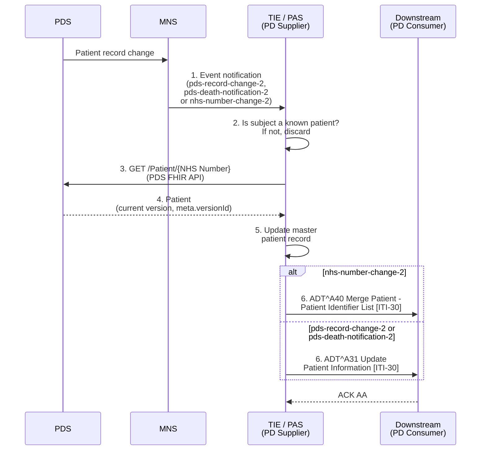

This scenario shows how a Trust keeps its patient records in step with the [Personal Demographics Service (PDS)](https://digital.nhs.uk/services/personal-demographics-service) using the NHS England [Multicast Notification Service (MNS)](https://digital.nhs.uk/developer/api-catalogue/multicast-notification-service). It then shows how each change is passed to local systems as an [ADT^A31 Update Patient Information [ITI-30]](ITI-30.html), or, for an NHS Number change, an [ADT^A40 Merge Patient - Patient Identifier List [ITI-30]](ITI-30.html).

<div class="alert alert-info">
<b>Summary:</b> MNS events are <b>signals only</b> and contain no demographic data. On every event the subscriber <b>shall</b> retrieve the current record from the PDS FHIR API. It then <b>shall</b> send the result to Patient Demographics Consumers as an <b>ADT^A31</b>, except for an NHS Number change, which <b>shall</b> be sent as an <b>ADT^A40</b> (Merge Option).
</div>

### MNS events used

| MNS event | Event type | Raised when | `subject` | Result |
|-----------|------------|-------------|-----------|--------|
| [PDS change event](https://digital.nhs.uk/developer/api-catalogue/multicast-notification-service/pds-change-event) | `pds-record-change-2` | A patient record is created or updated in PDS (name, address, telecom, GP, gender, birth date, security flag, ...) | NHS Number of the patient | ADT^A31 with the updated demographics |
| [Death notification event](https://digital.nhs.uk/developer/api-catalogue/multicast-notification-service/death-notification-event) | `pds-death-notification-2` | The patient's death status in PDS changes, either to deceased or back to not deceased (death removed) | NHS Number of the patient | ADT^A31 with PID-29 / PID-30 |
| [NHS number change event](https://digital.nhs.uk/developer/api-catalogue/multicast-notification-service/nhs-number-change-event) | `nhs-number-change-2` | The patient's NHS Number is changed in PDS | The **original** NHS Number. The new number is retrieved from PDS | ADT^A40 with the new NHS Number in PID-3 and the original NHS Number in MRG-1 |
{:.grid}

The `-1` versions of `pds-death-notification` and `nhs-number-change` are deprecated. Implementers **shall** use the `-2` events.

### Actors

| System | Role in this scenario | IHE actor |
|--------|-----------------------|-----------|
| PDS | Publishes the change events. Source of truth for national demographics | - |
| MNS | Delivers events to subscribers (FHIR notification or CloudEvent, over MESH or SQS) | - |
| Trust Integration Engine (TIE) or PAS | Subscribes to MNS, calls the PDS FHIR API, updates the Trust master patient record, sends ADT^A31 or ADT^A40 | [Patient Demographics Supplier](ActorDefinition-PatientDemographicsSupplier.html), PIX Patient Identity Source |
| Downstream systems (LIMS, RIS, EPR modules) | Receive ADT^A31 / ADT^A40 and update their local copy | [Patient Demographics Consumer](ActorDefinition-PatientDemographicsConsumer.html) |
{:.grid}

The MNS subscriber and the Patient Demographics Supplier can be the PAS itself or an integration engine in front of the PAS. In both cases the PAS master record **shall** be updated before the A31 is sent, so that later ITI-30 and ITI-31 messages carry the same demographics. The Patient Demographics Supplier and Consumers **shall** support the [Merge Option](PAM.html), which this UK extension already requires.

### Process flow



### Subscribing to MNS

Subscriptions are created with the MNS Subscription API (`POST /subscriptions`). The `criteria` field selects the events:

| Event | Example criteria | Notes |
|-------|------------------|-------|
| Death | `eventType='pds-death-notification-2'` | Subscribe to all, then discard events for patients the Trust does not hold |
| NHS number change | `eventType='nhs-number-change-2'` | Subscribe to all, then discard events for patients the Trust does not hold |
| PDS record change | `eventType='pds-record-change-2' AND changed_address=True` | Subscriptions **must not** be wider than needed (for example all patients). Only `True` boolean filters are supported. Negative filters are not. Other filters include `changed_name`, `changed_birthdate`, `changed_gender`, `changed_gp`, `changed_telecom`, `changed_security` and `registeredgpodscode` |
{:.grid}

Events for patients the Trust has no relationship with **should not** be actioned or even logged.

### Processing rules

On receipt of any of the three events, the subscriber:

1. **shall** check that the event `subject` (NHS Number) belongs to a patient in the Trust master patient index. If not, it **shall** discard the event without logging the patient details.
2. **should** discard duplicate events, matched on the event `id`.
3. **may** compare the event `versionid` (`meta.versionId`) with the version stored locally, to skip events already processed.
4. **shall** retrieve the current Patient from the PDS FHIR API: `GET https://api.service.nhs.uk/personal-demographics/FHIR/R4/Patient/{subject}` with an `X-Request-ID` header and a bearer token.
5. **shall** update the master patient record from the PDS response, keeping the local MRN (PID-3 `MR`) unchanged.
6. **shall** send an ADT^A31 to Patient Demographics Consumers, carrying the full current demographics (see [Expected Actions](ITI-30.html#expected-actions)). PID-3 **shall** include the local MRN, which is the identifier consumers match on. For `nhs-number-change-2` it **shall** send an ADT^A40 instead (see [Example 3](#example-3-nhs-number-change-nhs-number-change-2)).

If the subscriber does not hold the MRN for the NHS Number, it obtains it from the PAS with a patient demographics query. See [Working with NHS England APIs](nhs-england-apis.html#obtaining-the-mrn).

EVN-6 (Event Occurred) **should** be the event `time` from the notification. PID-33 (Last Update Date/Time) **may** carry the same value.

### Mapping PDS FHIR Patient to ADT^A31 / ADT^A40 PID

| PDS FHIR Patient | v2 field | Notes |
|------------------|----------|-------|
| `id` / `identifier` (`https://fhir.nhs.uk/Id/nhs-number`) | PID-3 (`NH`) | NHS Number. Add the local MRN (`MR`) from the master record |
| `identifier.extension` NHSNumberVerificationStatus | PID-32 | `01` → `NSTS01` |
| `name` (use = usual) | PID-5 (XPN-7 = `L`) | Other names repeat with XPN-7 = `A` |
| `birthDate` | PID-7 | |
| `gender` | PID-8 | `male` → `M`, `female` → `F`, `other` → `O`, `unknown` → `U` |
| `address` (use = home, current period) | PID-11 | |
| `telecom` | PID-13 | |
| `deceasedDateTime` | PID-29, PID-30 = `Y` | Death removed (no `deceasedDateTime`): PID-29 = `""` and PID-30 = `N` |
| `generalPractitioner` (Organization ODS code) | PD1-3 | XON-10 = ODS code. PDS gives the practice only. PD1-4 (GP) is kept from local data |
| `meta.security` = `R` (restricted) or `V` (very restricted) | ZU8-4 = `2` | PDS leaves out address, telecom, contact and GP. Send them as `""` only if the Trust's policy is to remove the stored values |
| `contact` | NK1 | |
{:.grid}

### Example 1: Change of address (`pds-record-change-2`)

Octavia CHISLETT moves house. The GP updates PDS. MNS sends this FHIR notification:

```json
{
  "resourceType": "Bundle",
  "id": "236a1d4a-5d69-4fa9-9c7f-e72bf505aa5b",
  "type": "history",
  "timestamp": "2026-11-24T09:30:00Z",
  "entry": [ {
    "fullUrl": "urn:uuid:3c3b9f3e-8b47-4c58-9e57-0b8f0c6a5a11",
    "resource": {
      "resourceType": "Parameters",
      "meta": { "profile": [ "http://hl7.org/fhir/uv/subscriptions-backport/StructureDefinition/backport-subscription-status-r4" ] },
      "parameter": [
        { "name": "subscription", "valueReference": { "reference": "https://api.service.nhs.uk/multicast-notification-service/subscriptions" } },
        { "name": "status", "valueCode": "active" },
        { "name": "type", "valueCode": "event-notification" },
        { "name": "notification-event", "part": [
          { "name": "event-number", "valueString": "1" },
          { "name": "timestamp", "valueInstant": "2026-11-24T09:30:00Z" } ] },
        { "name": "additional-context", "part": [
          { "name": "event-type", "valueString": "pds-record-change-2" },
          { "name": "source", "valueUri": "https://fhir.nhs.uk/Id/nhsSpineASID/477121000324" },
          { "name": "subject", "valueReference": { "identifier": { "system": "https://fhir.nhs.uk/Id/nhs-number", "value": "9449305552" } } },
          { "name": "version-id", "valueString": "W/\"5\"" } ] }
      ]
    },
    "request": { "method": "GET", "url": "https://api.service.nhs.uk/multicast-notification-service/subscriptions" },
    "response": { "status": "200" }
  } ]
}
```

The same event as a CloudEvent (internal subscribers only):

```json
{
  "specversion": "1.0",
  "id": "236a1d4a-5d69-4fa9-9c7f-e72bf505aa5b",
  "source": "https://fhir.nhs.uk/Id/nhsSpineASID/477121000324",
  "type": "pds-record-change-2",
  "time": "2026-11-24T09:30:00Z",
  "subject": "9449305552",
  "versionid": "W/\"5\""
}
```

The TIE finds `9449305552` in the master patient index (MRN123456), calls `GET .../Patient/9449305552` and receives (extract):

```json
{
  "resourceType": "Patient",
  "id": "9449305552",
  "meta": { "versionId": "5" },
  "identifier": [ { "system": "https://fhir.nhs.uk/Id/nhs-number", "value": "9449305552" } ],
  "name": [ { "use": "usual", "family": "CHISLETT", "given": [ "Octavia" ], "prefix": [ "Mrs" ] } ],
  "gender": "female",
  "birthDate": "2008-09-20",
  "address": [ { "use": "home", "period": { "start": "2026-11-20" }, "line": [ "2 New Road" ], "city": "MANCHESTER", "postalCode": "M20 2AB" } ],
  "generalPractitioner": [ { "type": "Organization", "identifier": { "system": "https://fhir.nhs.uk/Id/ods-organization-code", "value": "Y00001" } } ]
}
```

ADT^A31 sent to downstream systems:

```
MSH|^~\&|PAS|R0A|ROUTE|ROUTE|20261124093015+0000||ADT^A31^ADT_A05|MSG00101|P|2.5.1|||||GBR|UNICODE UTF-8|en||ITKv1.0
EVN||20261124093015+0000||||20261124093000+0000
PID|1||9449305552^^^NHS&2.16.840.1.113883.2.1.4.1&ISO^NH~MRN123456^^^R0A^MR^R0A||CHISLETT^Octavia^^^Mrs^^L||20080920|F|||2 New Road^^MANCHESTER^^M20 2AB^GBR^H||01632960587^PRN^PH||en|S||||||A||||||||||NSTS01|20261124093000+0000
PD1|||EXAMPLE GP PRACTICE^^Y00001^^^^^^^Y00001|G1234560^SMITH^Jane^^^Dr
PV1|1|N
```

### Example 2: Death notification (`pds-death-notification-2`)

The patient's death is registered and PDS is updated. The CloudEvent form of the notification is:

```json
{
  "specversion": "1.0",
  "id": "b01dd3dd-c8c1-486b-b881-fa87bbe5da44",
  "source": "https://fhir.nhs.uk/Id/nhsSpineASID/477121000323",
  "type": "pds-death-notification-2",
  "time": "2026-11-24T11:02:00Z",
  "subject": "9449305552",
  "versionid": "W/\"6\""
}
```

The TIE calls `GET .../Patient/9449305552`. The response now contains (extract):

```json
{
  "resourceType": "Patient",
  "id": "9449305552",
  "meta": { "versionId": "6" },
  "deceasedDateTime": "2026-11-22T14:30:00+00:00",
  "extension": [ {
    "url": "https://fhir.hl7.org.uk/StructureDefinition/Extension-UKCore-DeathNotificationStatus",
    "extension": [
      { "url": "deathNotificationStatus", "valueCodeableConcept": { "coding": [ {
        "system": "https://fhir.hl7.org.uk/CodeSystem/UKCore-DeathNotificationStatus",
        "code": "2", "display": "Formal - death notice received from Registrar of Deaths" } ] } },
      { "url": "systemEffectiveDate", "valueDateTime": "2026-11-24T11:02:00+00:00" }
    ]
  } ]
}
```

ADT^A31 sent to downstream systems, with PID-29 Patient Death Date and Time and PID-30 Patient Death Indicator:

```
MSH|^~\&|PAS|R0A|ROUTE|ROUTE|20261124110230+0000||ADT^A31^ADT_A05|MSG00102|P|2.5.1|||||GBR|UNICODE UTF-8|en||ITKv1.0
EVN||20261124110230+0000||||20261124110200+0000
PID|1||9449305552^^^NHS&2.16.840.1.113883.2.1.4.1&ISO^NH~MRN123456^^^R0A^MR^R0A||CHISLETT^Octavia^^^Mrs^^L||20080920|F|||2 New Road^^MANCHESTER^^M20 2AB^GBR^H||01632960587^PRN^PH||en|S||||||A|||||||20261122143000+0000|Y||NSTS01|20261124110200+0000
PD1|||EXAMPLE GP PRACTICE^^Y00001^^^^^^^Y00001|G1234560^SMITH^Jane^^^Dr
PV1|1|N
```

Notes:

- The same event is raised when a death is **removed** from PDS (for example, recorded against the wrong patient). PDS then returns no `deceasedDateTime`, and the A31 **shall** carry PID-29 = `""` and PID-30 = `N`, so that consumers delete the stored date of death.
- A death may be *informal* (code `1`, reported by a GP or Trust) before it is *formal* (code `2`, from the Registrar). Both are sent as PID-29 / PID-30. Whether local workflows (for example cancelling future appointments) act on informal deaths is a matter of local policy.
- If the patient is an inpatient, the Trust's own record of the death is normally an ADT^A03 discharge (PV1-36 Discharge Disposition = died) from the PAS [ITI-31](ITI-31.html). The A31 from PDS does not replace it.

### Example 3: NHS Number change (`nhs-number-change-2`)

PDS replaces the patient's NHS Number. The event `subject` is the **original** NHS Number:

```json
{
  "specversion": "1.0",
  "id": "b4413162-76d6-4ee1-98ef-dedf013a8c6e",
  "source": "https://fhir.nhs.uk/Id/nhsSpineASID/477121000323",
  "type": "nhs-number-change-2",
  "time": "2026-11-24T14:15:00Z",
  "subject": "9449305552",
  "versionid": "W/\"7\""
}
```

The TIE finds the original NHS Number in the master patient index (MRN123456) and calls `GET .../Patient/9449305552`. PDS returns the superseding record, whose `id` and NHS Number identifier are the **new** NHS Number (illustrative value `9449310602`). The TIE **shall** check whether the returned `id` differs from the requested NHS Number. If it does, the TIE replaces the NHS Number in the master record.

PDS changes an NHS Number when it resolves a duplicate: the original NHS Number is superseded by the surviving one. The TIE **shall** therefore send an ADT^A40 Merge Patient - Patient Identifier List, rather than an A31. PID-3 carries the surviving identifiers (new NHS Number and the MRN) with the full current demographics. MRG-1 carries the superseded NHS Number, in the same position as the NHS Number in PID-3 ([tightly coupled](ITI-30.html#message-structure---adta40-adt_a39)):

```
MSH|^~\&|PAS|R0A|ROUTE|ROUTE|20261124141530+0000||ADT^A40^ADT_A39|MSG00103|P|2.5.1|||||GBR|UNICODE UTF-8|en||ITKv1.0
EVN||20261124141530+0000||||20261124141500+0000
PID|1||9449310602^^^NHS&2.16.840.1.113883.2.1.4.1&ISO^NH~MRN123456^^^R0A^MR^R0A||CHISLETT^Octavia^^^Mrs^^L||20080920|F|||2 New Road^^MANCHESTER^^M20 2AB^GBR^H||01632960587^PRN^PH||en|S||||||A||||||||||NSTS01|20261124141500+0000
PD1|||EXAMPLE GP PRACTICE^^Y00001^^^^^^^Y00001|G1234560^SMITH^Jane^^^Dr
MRG|9449305552^^^NHS&2.16.840.1.113883.2.1.4.1&ISO^NH
```

FHIR: [Bundle-PDS-ADT-A40-NHSNumberChange](Bundle-Bundle-PDS-ADT-A40-NHSNumberChange.html). The surviving Patient (PID) has `link.type` = `replaces` and the superseded Patient (MRG) has `active` = false and `link.type` = `replaced-by`. Each `link.other` carries both a literal `reference` to the other Patient in the Bundle and its **NHS Number** (`Reference.identifier`, system `https://fhir.nhs.uk/Id/nhs-number`). The identifier lets a receiver resolve the link against its own patient index, where server resource ids differ between systems.

Consumers **shall** process the A40 as described in [Expected Actions](ITI-30.html#expected-actions): data held against the original NHS Number is merged into the record identified by PID-3, and the original NHS Number **shall not** be treated as active. It **should** be kept as an inactive identifier for audit and for matching results that arrive late. Consumers that key on the MRN find the same record. Consumers that key on the NHS Number find it through MRG-1.

Notes:

- If the Trust holds **two** local records, one for each NHS Number (for example MRN123456 for `9449310602` and MRN999999 for `9449305552`), the PAS merges them as well. MRG-1 then also carries the non-surviving MRN in the same position as the MRN in PID-3: `MRG|9449305552^^^NHS&2.16.840.1.113883.2.1.4.1&ISO^NH~MRN999999^^^R0A^MR^R0A`. Where the PAS cannot merge automatically, the event **should** raise a task for the Trust's patient records team, and the A40 is sent when the merge is done.
- If the PDS response has the **same** `id` as the requested NHS Number, the NHS Number has not changed. The TIE **shall not** send an A40, and handles the event as a record change (A31).

### Sensitive (S-flag) patients

If the PDS record has `meta.security` = `R` (restricted), PDS leaves out the patient's address, telecom, contacts and GP. The A31 **shall** set ZU8-4 Location Hiding to `2` (national S-flag determines location hiding). It **shall not** send any location details the Trust already holds to systems that are not permitted to see them. A `changed_security` event can also mean that the NHS Number has been invalidated and should no longer be used. See [Location hiding](hl7v2-zsegments.html#location-hiding).

```
ZU8||||2
```

### FHIR equivalent

The FHIR form of each A31 is a message Bundle whose focus is a [PAM Patient](StructureDefinition-PAMPatient.html), as in [MessageDefinition ADT-A31](MessageDefinition-ADT-A31.html). The FHIR form of the A40 follows [MessageDefinition ADT-A40](MessageDefinition-ADT-A40.html): the Patient identified by the original NHS Number has `active` = false and a `link` of type `replaced-by` to the surviving Patient, with `link.other` giving both the reference and the NHS Number identifier ([example](Bundle-Bundle-PDS-ADT-A40-NHSNumberChange.html)) (see [PMIR](PMIR.html) for the equivalent FHIR feed). The `deceasedDateTime`, `identifier` (NHS Number) and `address` values are copied from the PDS response. The local MRN is added as the `localPatientIdentifier` slice.

### Error handling

| Situation | Action |
|-----------|--------|
| PDS returns 404, or the record is invalidated | Do not send an A31 or A40. Raise a data quality task for the Trust's patient records team |
| PDS rate limit (HTTP 429) or unavailable | Retry with back-off. Events **should** be processed in `time` order per patient |
| PDS `meta.versionId` is older than the version already stored | Do not send an A31 or A40. A later event has already been processed |
| ACK AE/AR from a consumer | Handle as for any ITI-30 message |
{:.grid}
