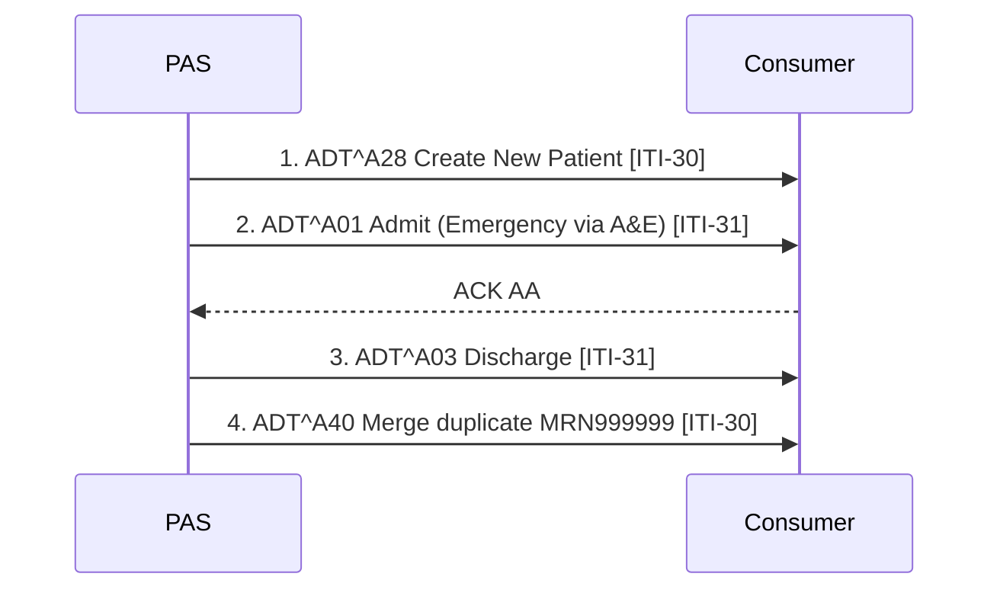

### Test patient

The examples use the NHS test patient **Octavia CHISLETT** (NHS Number `9449305552`), as used in the [NW Genomics guide](https://nw-gmsa.github.io/en/). Organisation, practitioner and location codes are illustrative: `R0A` (Manchester University NHS Foundation Trust), and the HSCIC ITK example codes `Y00001` (GP practice) and `G1234560` (GP). Segments are shown one per line; on the wire each segment ends with `<cr>`.

### Scenario



### 1. ADT^A28 Create New Patient [ITI-30]

```
MSH|^~\&|PAS|R0A|ROUTE|ROUTE|20261119153000+0000||ADT^A28^ADT_A05|MSG00001|P|2.5.1|||||GBR|UNICODE UTF-8|en||ITKv1.0
EVN||20261119153000+0000||||20261119152900+0000
PID|1||9449305552^^^NHS&2.16.840.1.113883.2.1.4.1&ISO^NH~MRN123456^^^R0A^MR^R0A||CHISLETT^Octavia^^^Mrs^^L||20080920|F|||1 Example Street^^MANCHESTER^^M13 9WL^GBR^H||01632960587^PRN^PH||en|S||||||A||||||||||NSTS01
PD1|||EXAMPLE GP PRACTICE^^Y00001^^^^^^^Y00001|G1234560^SMITH^Jane^^^Dr
NK1|1|CHISLETT^Mary|12^Mother||07700900123^ORN^CP
PV1|1|N
ZU8||||0
```

FHIR: [Bundle-ADT-A28](Bundle-Bundle-ADT-A28.html)

### 2. ADT^A01 Admit Inpatient [ITI-31]

Emergency admission via A&E (PV1-4 `21`) from usual place of residence (PV1-14 `19`) to Ward 12 bed 3, under consultant C1234567, in treatment function `300` (General Medicine). The decision to admit (ZU1-1) was made at 09:45.

```
MSH|^~\&|PAS|R0A|ROUTE|ROUTE|20261120101602+0000||ADT^A01^ADT_A01|MSG00002|P|2.5.1|||||GBR|UNICODE UTF-8|en||ITKv1.0
EVN||20261120101602+0000||||20261120101500+0000
PID|1||9449305552^^^NHS&2.16.840.1.113883.2.1.4.1&ISO^NH~MRN123456^^^R0A^MR^R0A||CHISLETT^Octavia^^^Mrs^^L||20080920|F|||1 Example Street^^MANCHESTER^^M13 9WL^GBR^H||01632960587^PRN^PH||en|S||||||A||||||||||NSTS01
PD1|||EXAMPLE GP PRACTICE^^Y00001^^^^^^^Y00001|G1234560^SMITH^Jane^^^Dr
PV1|1|I|^W12^3^R0A02|21|||||C1234567^JONES^Alan^^^Dr|300||||19|||C1234567^JONES^Alan^^^Dr||V0001234^^^R0A^VN|||||||||||||||||||||||||20261120101500+0000
ZU1|20261120094500+0000|1
```

FHIR: [Bundle-ADT-A01](Bundle-Bundle-ADT-A01.html)

#### Acknowledgement

```
MSH|^~\&|LIMS|R0A|PAS|R0A|20261120101603+0000||ACK^A01^ACK|ACK00002|P|2.5.1|||||GBR||en
MSA|AA|MSG00002
```

### 3. ADT^A03 Discharge Patient [ITI-31]

Discharged on clinical advice (PV1-36 `1`) to usual place of residence (PV1-37 `19`).

```
MSH|^~\&|PAS|R0A|ROUTE|ROUTE|20261123140110+0000||ADT^A03^ADT_A03|MSG00003|P|2.5.1|||||GBR|UNICODE UTF-8|en||ITKv1.0
EVN||20261123140110+0000||||20261123140000+0000
PID|1||9449305552^^^NHS&2.16.840.1.113883.2.1.4.1&ISO^NH~MRN123456^^^R0A^MR^R0A||CHISLETT^Octavia^^^Mrs^^L||20080920|F|||1 Example Street^^MANCHESTER^^M13 9WL^GBR^H||01632960587^PRN^PH||en|S||||||A||||||||||NSTS01
PD1|||EXAMPLE GP PRACTICE^^Y00001^^^^^^^Y00001|G1234560^SMITH^Jane^^^Dr
PV1|1|I|^W12^3^R0A02|21|||||C1234567^JONES^Alan^^^Dr|300||||19|||C1234567^JONES^Alan^^^Dr||V0001234^^^R0A^VN|||||||||||||||||1|19|||||||20261120101500+0000|20261123140000+0000
ZU1|20261120094500+0000|1
```

FHIR: [Bundle-ADT-A03](Bundle-Bundle-ADT-A03.html)

### 4. ADT^A40 Merge Patient [ITI-30]

Duplicate record `MRN999999` (MRG-1) is merged into `MRN123456` (PID-3).

```
MSH|^~\&|PAS|R0A|ROUTE|ROUTE|20261123160000+0000||ADT^A40^ADT_A39|MSG00004|P|2.5.1|||||GBR|UNICODE UTF-8|en||ITKv1.0
EVN||20261123160000+0000||||20261123155900+0000
PID|1||9449305552^^^NHS&2.16.840.1.113883.2.1.4.1&ISO^NH~MRN123456^^^R0A^MR^R0A||CHISLETT^Octavia^^^^^L||20080920|F
MRG|MRN999999^^^R0A^MR^R0A
```

FHIR: [Bundle-ADT-A40](Bundle-Bundle-ADT-A40.html)

### Validation

- **HL7 v2.5.1:** messages can be checked against HL7 v2.5.1 with tools such as the [NIST HL7 v2 validation tools](https://hl7v2tools.nist.gov/) or Gazelle (IHE PAM test plans). The UK Z segments need a custom profile.
- **FHIR:** FHIR resources can be validated against the profiles in this guide with the [HL7 FHIR Validator](https://confluence.hl7.org/display/FHIR/Using+the+FHIR+Validator), e.g. `java -jar validator_cli.jar bundle.json -version 4.0.1 -ig ihe.uk.iti.pam`.
