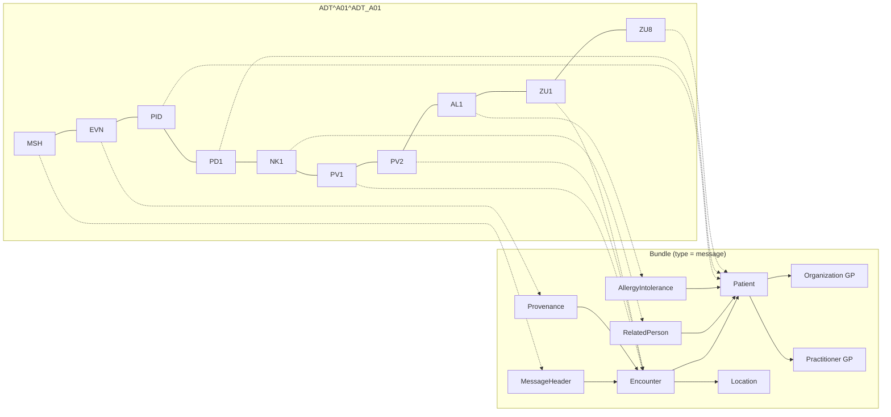

This page summarises how the HL7 v2.5.1 ADT model maps to HL7 FHIR R4. The approach follows the [HL7 v2-to-FHIR Implementation Guide](https://build.fhir.org/ig/HL7/v2-to-fhir/), adapted for HSCIC ITK content, [HL7 Europe Base](https://hl7.eu/fhir/base/) and UK Core. Each profile also has a **Mappings** tab that lists the v2 field for each element.

### Base profile selection

| v2 | FHIR profile | Parent | Reason |
|----|--------------|--------|--------|
| PID, PD1, ZU1-10, ZU8 | [PAM Patient](StructureDefinition-PAMPatient.html) | HL7 EU `patient-eu` | `patient-eu-core` requires `birthDate`, but PID-7 is RE in HSCIC ITK |
| PV1, PV2, ZU1 | [PAM Encounter](StructureDefinition-PAMEncounter.html) | FHIR R4 Encounter | HL7 Europe Base has no Encounter profile |
| PL | [PAM Location](StructureDefinition-PAMLocation.html) | HL7 EU `location-eu-core` | |
| XCN | [PAM Practitioner](StructureDefinition-PAMPractitioner.html) | HL7 EU `practitioner-eu` | |
| XON / HD | [PAM Organization](StructureDefinition-PAMOrganization.html) | HL7 EU `organization-eu` | |
| NK1 | [PAM Related Person](StructureDefinition-PAMRelatedPerson.html) | FHIR R4 RelatedPerson | No HL7 EU profile |
| AL1 | [PAM Allergy Intolerance](StructureDefinition-PAMAllergyIntolerance.html) | HL7 EU `allergyIntolerance-eu-core` | |
| DG1 | [PAM Condition](StructureDefinition-PAMCondition.html) | HL7 EU `condition-eu-core` | |
| PR1 | [PAM Procedure](StructureDefinition-PAMProcedure.html) | HL7 EU `procedure-eu-core` | |
| MSH | [PAM Message Header](StructureDefinition-PAMMessageHeader.html) | FHIR R4 MessageHeader | |
| EVN | [PAM Event](StructureDefinition-PAMProvenance.html) | FHIR R4 Provenance | As in HL7 v2-to-FHIR |
| message | [PAM Message Bundle](StructureDefinition-PAMBundleMessage.html) | FHIR R4 Bundle | |
| CX | [PAM Identifier](StructureDefinition-PAMIdentifier.html), [NHS Number](StructureDefinition-NHSNumber.html), [Local Patient Identifier](StructureDefinition-LocalPatientIdentifier.html), [Visit Number](StructureDefinition-VisitNumber.html) | Identifier | |
{:.grid}

<b>Known issue:</b> the HL7 Europe <code>*-eu-core</code> clinical profiles (AllergyIntolerance, Condition, Procedure) constrain their subject to <code>patient-eu-core</code>. Because PAM Patient is based on <code>patient-eu</code>, a PAM Patient without a <code>birthDate</code> will not meet those subject constraints. Feedback to HL7 Europe is proposed.

### Message to Bundle

### Trigger event to FHIR

| v2 | FHIR |
|----|------|
| MSH-9.2 trigger event | `MessageHeader.eventCoding` (HL7 Table 0003) and `Provenance.activity` |
| ITI-31 event | `Encounter.status` and `Encounter.location.status`, as in the [ITI-31 table](ITI-31.html#trigger-events-and-encounter-status) |
| Cancel events | The same Encounter resource, with the state reverted (or `entered-in-error`) |
| A40 MRG | `Patient.link` (`replaces` / `replaced-by`) and `active` = false on the non-surviving Patient |
{:.grid}

### Datatype mapping

| v2.5.1 | FHIR | Notes |
|--------|------|-------|
| CX | Identifier | CX-1 → value; CX-4 → system (`NHS` → `https://fhir.nhs.uk/Id/nhs-number`; HD-2 Universal ID → `urn:oid:<OID>`; local HD-1 namespace only → system omitted, no URI is invented); CX-5 → type; CX-6 → assigner.identifier (ODS) |
| XPN | HumanName | XPN-1 → family; XPN-2, XPN-3 → given; XPN-4 → suffix; XPN-5 → prefix; XPN-7 → use ([ConceptMap](ConceptMap-HSCICNameTypeToFHIR.html)) |
| XAD | Address | XAD-1, XAD-2 → line; XAD-3 → city; XAD-4 → district; XAD-5 → postalCode; XAD-6 → country; XAD-7 → use/type ([ConceptMap](ConceptMap-HSCICAddressTypeToFHIR.html)) |
| XTN | ContactPoint | XTN-1 / XTN-12 → value; XTN-2 → use (PRN → home, WPN → work, ORN + CP → mobile); XTN-3 → system (PH/CP → phone, FX → fax, Internet → email); XTN-4 → value (email) |
| XCN | Reference(Practitioner) | XCN-1 → identifier (gmp-number / gmc-number); XCN-2..6 → name |
| XON | Reference(Organization) | XON-10 (or XON-3) → identifier (ODS); XON-1 → name |
| PL | Reference(Location) | PL-2 ward, PL-3 bed, PL-4 facility (ODS site) |
| CE / CWE | CodeableConcept | CE-1 → code; CE-2 → display; CE-3 → system (see [Terminology](terminology.html)) |
| TS / DTM | dateTime | `YYYYMMDDHHMMSS+ZZZZ` → `YYYY-MM-DDThh:mm:ss+zz:zz` |
| ID/IS (Y/N, table 0136) | boolean | |
{:.grid}

### Terminology mapping

See [Terminology and Reference Tables](terminology.html) for the ConceptMaps (HL7 v2 tables → NHS Data Dictionary → FHIR).
